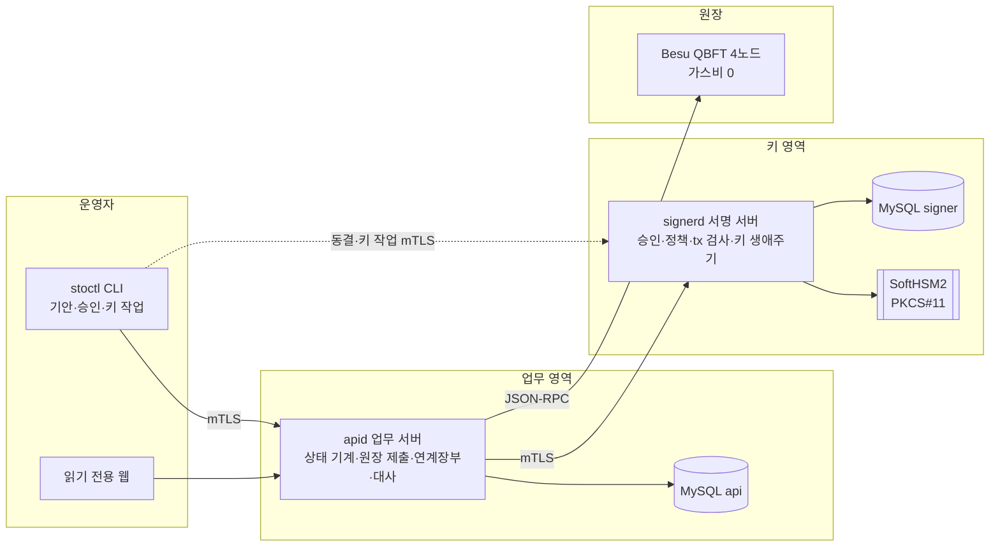

# 토큰증권 키 관리·서명 시스템 MVP

토큰증권(STO) 분산원장에서 **업무 서버는 키를 갖지 않고, 분리된 서명 서버가 HSM(PKCS#11) 안의 키로 승인된 요청만 서명하는** 구조를 허가형 분산원장(Hyperledger Besu) 위에서 구현한 MVP 다.

## 목적

한국예탁결제원 「토큰증권 분산원장 표준요건 가이드라인」(2026년 9월)의 지갑·키 관리 요건(C-2-1, C-2-2)과 관련 요건을 실제로 동작하는 코드로 보인다.

- 키는 HSM 안에서 만들고 밖으로 꺼내지 않는다. 기관마다 HSM 토큰과 PIN 을 나눈다.
- 서명 서버는 기관 승인자 M명의 서명(Ed25519)이 붙고, 정책을 통과하고, 승인한 내용과 트랜잭션이 바이트 단위로 같은 요청만 서명한다. 업무 서버가 침해돼도 임의로 서명받을 수 없다.
- 키의 생성·교체·폐기·백업·복구와 분실·도난 대응을 보안관리자 M-of-N 승인 절차로 운영하고, 모든 결정을 해시 체인 감사로그와 HSM 서명 체크포인트로 남긴다.
- 권리자 실명은 오프체인 연계장부에만 두고, 원장과 연계장부를 대사한다.

## 구성



| 구성 요소 | 위치 | 역할 |
|---|---|---|
| 업무 서버 | `cmd/apid` | 기안·승인 수집, 요청 상태 기계, nonce, 원장 제출·확정, 이벤트 보존, 연계장부, 대사, 알람, 읽기 전용 웹 |
| 서명 서버 | `cmd/signerd` | 9단계 서명 검사, PKCS#11 서명, 키 작업, 동결, 정책 변경, 감사 체크포인트 |
| 관리 CLI | `cmd/stoctl` | 기안·승인(승인자 키 서명), 키 작업, 동결, 계좌, 대사, 감사 검증 |
| 컨트랙트 | `contracts/src/SecurityToken.sol` | 종목별 토큰증권(역할, 기관 대응, 처분제한, 유통 정지). ERC-20 이전 함수 없음 |

서명 서버는 원장 노드에 접속하지 않고, 업무 서버는 HSM 에 접근하지 못한다(`make lint`가 import 경계를 검사한다).

## 시작 방법

필요한 도구: Docker(Compose v2), Go(`go.mod` 버전), Foundry(컨트랙트 시험·바인딩 생성 시), `jq`, `python3`.

```bash
git submodule update --init
```

```bash
make build
```

```bash
make up
```

```bash
make migrate
```

`make up`은 노드 키·비밀·인증서·승인자 키를 생성하고(커밋 금지 경로, 아래 참조) Besu 4노드·MySQL·서명 서버·업무 서버를 띄운다. 끝나면 다음으로 확인한다.

```bash
make test && make lint && make test-contracts && make it
```

종료는 `make down`(데이터 볼륨은 남는다)이다. 원장·DB·HSM 토큰까지 처음 상태로 돌리려면 `docker compose -f deploy/docker-compose.yml down -v`로 볼륨을 지운다. 이 명령은 모든 키와 원장 데이터를 지우므로 되돌릴 수 없다.

## 시연 방법

```bash
make demo
```

사람 개입 없이 다음을 순서대로 실행하고 단계별 결과를 출력한다(깨끗한 환경에서 약 2분 10초, 종목이 많을수록 키 교체·도난 대응이 길어진다).

1. 정상 흐름: 종목 배포 → 연계장부 계좌 등록 → 화이트리스트 추가 → 발행 → 계좌대체 → 보유 수량
2. 거부 사례: 승인 부족, 자기 승인, 한도 초과, 타 기관 키, calldata 바꿔치기
3. 키 교체: 기관 A 발행 키 교체 → 새 키로 발행
4. 도난 대응: 동결 → 탈취 키 시도 거부 → 역할 회수 → 유통 정지 → 새 키 → 재개 → 폐기
5. 감사 검증과 변조 탐지
6. 대사 불일치 탐지

시연 중 상태 변화는 읽기 전용 웹 `http://127.0.0.1:9080/`에서 볼 수 있다. 개별 시나리오는 `scripts/bootstrap-security.sh`, `scripts/incident-key-compromise.sh`, `scripts/rehearsal-restore.sh`로도 실행한다. 명령 전체 목록은 [CLAUDE.md](CLAUDE.md)의 명령 표에 있다.

## 문서

| 문서 | 내용 |
|---|---|
| [01 개발요구사항 및 결정사항](docs/01_개발요구사항_및_결정사항.md) | 근거 규정, 기능·비기능 요구사항, 결정사항(D-1~D-24), 미확정 항목, 리스크 |
| [02 개발설계서](docs/02_개발설계서.md) | 구성, 흐름, 서명 검사, HSM, 정책, 감사, 키 생애주기, 원장 연계, 데이터 모델, API, 위협 모델 |
| [03 작업지시서](docs/03_작업지시서.md) | 작업 목록과 진행 현황 |
| [04 키관리 정책 설명서](docs/04_키관리_정책_설명서.md) | 키 분류부터 역할과 책임까지 절차별 명령·승인 수·감사 기록 |
| [05 요건 대응표](docs/05_요건_대응표.md) | 가이드라인 항목별 구현 위치, 검증 테스트, 증빙 |
| [증빙](docs/증빙/) | HSM 서명·래핑 실측, 복구 리허설 결과 |

## 한계

MVP 이므로 다음은 운영 수준이 아니다. 자세한 내용은 [04 11절](docs/04_키관리_정책_설명서.md#11-mvp-의-한계)과 [01 리스크](docs/01_개발요구사항_및_결정사항.md)에 있다.

- HSM 은 소프트웨어 구현(SoftHSM2)이다. PKCS#11 표준이라 실물 HSM 으로 바꿀 수 있지만 물리 보호·인증 등급은 없다.
- 승인자 키는 로컬 파일이고, 시연 자동화를 위해 그 암호도 `deploy/secrets/`에 있다.
- 정책 변경은 화이트리스트 추가만 구현했다. 승인자 변경, 정책 본문 변경은 부트스트랩으로만 한다. 기안자 인증이 없다.
- 실제 토큰 분실 시 운영 서명 서버에서의 복원 경로는 시험용 대역으로만 확인했다(복구 리허설은 실제 SoftHSM2 로 통과).
- 읽기 전용 웹에 인증이 없다. 호스트 쪽은 127.0.0.1 로만 게시한다.
- 대사는 불일치를 보고만 한다. 연계장부 정정 명령은 없다.
- 원장은 로컬 Besu 만 지원한다. Fabric 어댑터와 MPC 서명기(M5)는 구현하지 않았다. 메인넷·외부 공개망에는 접속하지 않는다.

생성물과 비밀은 커밋하지 않는다: `deploy/besu/generated/`, `deploy/secrets/`, `deploy/approvers/`, `deploy/signerd/generated/`, `deploy/certs/`, `deploy/ceremony/`, `deploy/backups/`.
