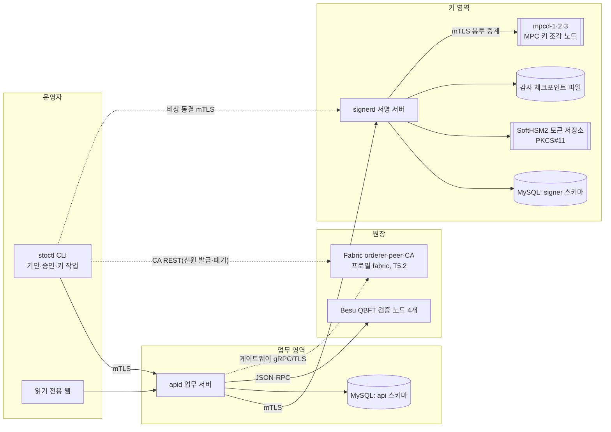
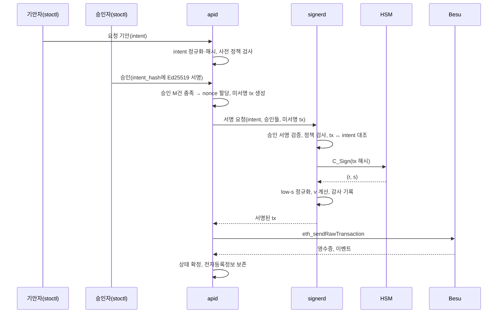
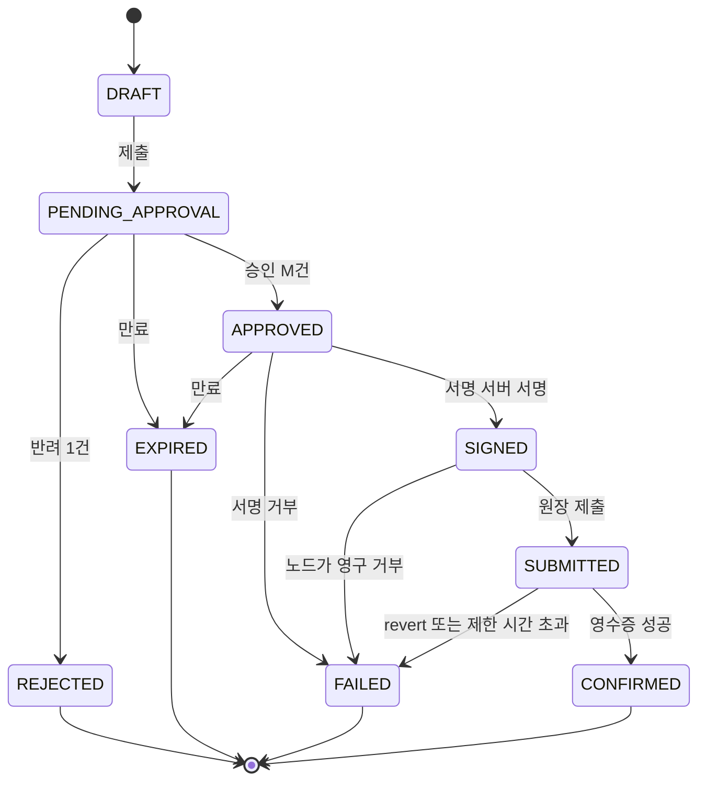

# 토큰증권 키 관리·서명 시스템 MVP — 개발 설계서

> 문서 버전: v1.7 (2026-11-28, M5 T5.1·T5.2 설계 반영) · 요구사항: [01_개발요구사항_및_결정사항.md](01_개발요구사항_및_결정사항.md) · 작업지시서: [03_작업지시서.md](03_작업지시서.md)
>
> 이 설계서는 구현 전 설계다. "실측 필요"로 표시한 항목은 M0에서 확인한 뒤 결과를 요구사항 문서의 결정사항에 기록하고 이 문서를 고친다.

---

## 1. 설계 원칙

1. **키에 닿는 경로는 하나다.** HSM 토큰 저장소와 PIN은 서명 서버(`signerd`)만 접근한다.
2. **신뢰의 기준점은 서명 서버다.** 업무 서버(`apid`)가 침해되어도, 승인자 서명이 없는 요청과 정책 밖의 요청은 서명되지 않는다.
3. **서명 서버는 자기가 무엇에 서명하는지 안다.** 원문 트랜잭션을 해석해 승인된 내용과 일치하는지 확인한다.
4. **모든 권한 행사는 증적을 남긴다.** 감사로그는 추가 전용 해시 체인이고, 누구든 검증할 수 있다.
5. **교체 가능한 경계를 둔다.** 서명기(HSM, MPC)와 원장 어댑터(Besu, Fabric)는 인터페이스 뒤에 둔다.

## 2. 구성



| 구성 요소 | 실행 파일 | 역할 |
|---|---|---|
| 업무 서버 | `cmd/apid` | 요청 기안·승인 수집, 상태 기계, nonce 관리, 원장 제출, 이벤트 수신, 연계장부, 대사, 알람 |
| 서명 서버 | `cmd/signerd` | 승인 서명 검증, 정책 검사, 트랜잭션 해석, PKCS#11 서명, 키 생애주기, 동결, 감사 체크포인트 |
| MPC 노드 | `cmd/mpcd` | 2-of-3 임계값 ECDSA 키 조각 보관과 분산 키 생성·서명(노드 3개, 서명 서버만 호출, T5.1·D-25) |
| 관리 CLI | `cmd/stoctl` | 기안, 승인(승인자 키로 서명), 키 작업 요청, 동결, 감사 검증, 시연 |
| HSM | SoftHSM2 | 키 생성·보관·서명. 서명 서버 컨테이너 안의 라이브러리이며 토큰 저장소 볼륨은 서명 서버만 마운트한다 |
| 원장 | Hyperledger Besu | QBFT 합의, 검증 노드 4개, 가스비 0, 허가형 |
| 원장(선택) | Hyperledger Fabric 2.5 | orderer 1, InstAMSP peer 1, Fabric CA 1, CCaaS 체인코드(`cmd/sectoken-cc`). compose 프로필 `fabric`, `make up-fabric`(T5.2, D-26, 10.5) |
| DB | MySQL 8 | `api`, `signer` 스키마를 분리하고 DB 계정도 분리한다 |

시연용 주체(D-8)

| 주체 | ID | HSM 토큰 | 보유 키 용도 |
|---|---|---|---|
| 플랫폼 운영 주체 | `platform` | `besu-local.platform` | 컨트랙트 관리(CONTRACT_ADMIN), 비상 통제(EMERGENCY) |
| 계좌관리기관 A | `inst-a` | `besu-local.inst-a`, `fabric-local.inst-a`(T5.2) | 발행(ISSUE), 계좌대체(TRANSFER). Fabric 토큰에는 P-256 신원 키 |
| 계좌관리기관 B | `inst-b` | `besu-local.inst-b` | 계좌대체(TRANSFER) |
| 감사 | `audit` | `audit` | 감사 체크포인트 서명(AUDIT) |

## 3. 저장소 구조

```
sto-key-management-signing-mvp/
├─ CLAUDE.md
├─ Makefile
├─ go.mod
├─ cmd/
│  ├─ apid/            업무 서버
│  ├─ signerd/         서명 서버
│  ├─ stoctl/          관리 CLI
│  ├─ mpcd/            MPC 키 조각 노드(3개 실행, D-25)
│  └─ sectoken-cc/     Fabric 체인코드(CCaaS, D-26)
├─ internal/
│  ├─ version/         실행 파일 버전 정보
│  ├─ config/          YAML 설정과 비밀 파일 읽기
│  ├─ server/          mTLS 서버 실행, 헬스 확인 호출
│  ├─ signsvc/         서명 서버의 tx 서명 처리(5.3 검사 순서)
│  ├─ intent/          요청 내용(intent) 구조, 정규화, 해시
│  ├─ approval/        승인자 키, 승인 서명 생성·검증
│  ├─ policy/          정책 모델과 평가
│  ├─ hsm/             PKCS#11 세션, 키 생성·서명·래핑
│  ├─ signer/          Signer 인터페이스, 키 용도·부류, EVM 서명 완성(cgo·hsm 의존 없음)
│  │  ├─ hsm/          Signer 의 PKCS#11 구현
│  │  ├─ mpc/          Signer 의 MPC 구현(조정자, 메시지 중계. alice 를 import 하지 않는다, D-25)
│  │  └─ router/       키별 서명기 선택(HSM, MPC)
│  ├─ mpcwire/         MPC 노드와 조정자 사이 API·봉투 서명 형식(alice 없음)
│  ├─ mpcnode/         MPC 노드: alice CGGMP 세션, 조각 저장(암호화)
│  ├─ evmtx/           트랜잭션 생성, 해석(calldata 디코딩), intent 대조
│  ├─ keyreg/          키 레지스트리와 키 상태
│  ├─ keyops/          승인된 키 작업(생성·퇴역·폐기·백업·복원, 보안관리자 M명 서명)
│  ├─ adminsig/        보안관리자 M-of-N 서명 확인(키 작업·정책 변경 공용)
│  ├─ policychange/    승인된 정책 변경(화이트리스트 추가, D-22)
│  ├─ backup/          루트 키 백업 파일과 래핑 키 Shamir 조각 형식(cgo 없음)
│  ├─ audit/           해시 체인 감사로그, 검증, 체크포인트
│  ├─ ledger/          Ledger 어댑터 인터페이스
│  │  ├─ besu/         Besu 구현(업무 서버만), sectoken/ 컨트랙트 Go 바인딩(abigen 생성물)
│  │  └─ fabric/       Fabric 게이트웨이 어댑터(업무 서버만, 오프라인 서명, D-26)
│  ├─ fabricca/        Fabric CA REST 클라이언트(stoctl, 토큰 low-S)
│  ├─ workflow/        요청 상태 기계
│  ├─ registry/        이벤트 수신, 전자등록정보 보존
│  ├─ linked/          연계장부(계좌 등록, 보유 수량 반영)
│  ├─ recon/           대사(계좌 잔고·총발행량·이벤트 재생, D-23)
│  ├─ alarm/           이상 징후 규칙
│  ├─ freeze/          동결·해제 요청 서명과 검증
│  ├─ store/           DB 접근(api, signer)
│  └─ transport/       mTLS 서버·클라이언트, HTTP 핸들러
├─ contracts/          Solidity 컨트랙트(src/)와 Foundry 테스트(test/), lib/ 는 태그 고정 git 서브모듈
├─ migrations/
│  ├─ api/
│  └─ signer/
├─ deploy/
│  ├─ docker-compose.yml
│  ├─ besu/            genesis, 노드 키, 설정
│  ├─ signerd/         Dockerfile(SoftHSM2 포함), softhsm2.conf, signerd.yaml, bootstrap.tmpl.yaml, generated/(커밋 금지)
│  ├─ apid/            Dockerfile, apid.yaml
│  ├─ mysql/           초기화 스크립트(스키마·계정), 헬스체크
│  ├─ secrets/         비밀 파일(생성물, 커밋 금지)
│  ├─ approvers/       암호화된 승인자 키 파일(생성물, 커밋 금지)
│  └─ certs/           로컬 CA와 인증서(생성물, 커밋 금지)
├─ scripts/            인증서 생성, 토큰 초기화, 실측(probe-hsm), 마이그레이션(dbmigrate), 시연(demo.sh, demo-attack), 요건 대응표 확인
├─ test/               통합 테스트(-tags integration)
└─ docs/
   └─ 증빙/            실측·리허설 결과
```

## 4. 기술 선택

| 영역 | 선택 | 비고 |
|---|---|---|
| 언어 | Go | 착수 시점의 최신 안정 버전을 확인해 `go.mod`에 고정 |
| PKCS#11 | `github.com/miekg/pkcs11` | cgo 필요. 서명 서버 이미지에 SoftHSM2 라이브러리 포함 |
| EVM | `github.com/ethereum/go-ethereum` | 트랜잭션 타입, RLP, ABI, `ethclient`, `abigen` |
| HTTP | 표준 `net/http` | 외부 프레임워크 없이 구성 |
| DB | `database/sql` + `go-sql-driver/mysql`, 마이그레이션은 `golang-migrate`를 라이브러리로 쓰는 `scripts/dbmigrate` | ORM을 쓰지 않는다 |
| CLI | `cobra` | |
| 컨트랙트 | Solidity + OpenZeppelin, Foundry로 컴파일·테스트 | Go 바인딩은 `abigen` |
| 비밀 분할 | 검증된 공개 Shamir 구현 | 직접 구현하지 않는다 |
| 실행 | Docker Compose | |

버전은 이 문서에 적지 않는다. 착수 시점에 공식 문서로 확인해 `go.mod`, Dockerfile, `foundry.toml`에 고정한다.

M0에서 고정한 버전(공식 배포처에서 확인): Go 1.27.4, go-ethereum v1.17.10, miekg/pkcs11 v1.1.2, golang-migrate v4.20.1, go-sql-driver/mysql v1.10.2, Besu 26.11.2, MySQL 8.4.13, SoftHSM2 2.6.1(Debian trixie). 이후 버전은 `go.mod`, Dockerfile, Compose 파일이 기준이다.

## 5. 핵심 흐름

### 5.1 트랜잭션 서명 요청



### 5.2 intent와 승인

intent는 사람이 승인하는 대상이다. 원시 트랜잭션이 아니라 업무 의미를 담는다.

```json
{
  "request_id": "01JD…(ULID)",
  "type": "TX",
  "ledger_id": "besu-local",
  "institution_id": "inst-a",
  "key_purpose": "ISSUE",
  "contract": "0x…",
  "function": "issue(address,uint256)",
  "args": ["0x…", "1000"],
  "drafter_id": "apr-a-01",
  "expires_at": "2026-12-01T09:00:00Z"
}
```

- 정규화: 키를 사전순으로 정렬하고 공백 없는 UTF-8 JSON으로 직렬화한다(RFC 8785 방식). 숫자는 문자열로 표기한다.
- `intent_hash = SHA-256(정규화 바이트)`
- 정규 값 규칙(M1 구현, `internal/intent`): 같은 의미의 intent가 항상 같은 해시를 갖도록 비정규 표기는 거부한다.
  - `request_id`: 대문자 ULID 26자. `ledger_id`·`institution_id`·`drafter_id`: 소문자·숫자·`._-` 1~64자
  - `contract`와 address 인자: EIP-55 체크섬 표기
  - `function`: 공백 없는 정규 서명(예: `issue(address,uint256)`). 지원 타입은 `address`, `bool`, `string`, `bytes32`, `uint8`~`uint256`(별칭 `uint` 불가)
  - 수량(uintN): 선행 0 없는 10진수 문자열. `bytes32`: `0x` + 소문자 16진수 64자. `string`: 제어 문자 불가
  - `expires_at`: `YYYY-MM-DDTHH:MM:SSZ`(UTC, 소수점 없음). 알 수 없는 필드와 빠진 필드는 거부
  - 정규화 바이트는 HTML 이스케이프를 하지 않는다. 테스트 벡터는 `internal/intent/intent_test.go`에 있다.
- 배포 intent(T3.3, D-19): `type = "DEPLOY"`, `contract` = 0 주소, `function` = `constructor(…)`(예: `constructor(string,string,address)` = 종목명, 종목 코드, 관리자 주소), `args` = 생성자 인자, 그리고 DEPLOY 에만 있는 `code_hash` = 생성 바이트코드의 keccak256(`0x` + 소문자 16진수 64자). TX 에 `code_hash`가 있거나 DEPLOY 에 없으면 거부한다. TX intent 의 정규화·해시는 바뀌지 않는다. 승인자는 `stoctl request approve`가 보여 주는 `code_hash`를 승인한다.
- Fabric intent(T5.2, D-26): `type = "FABRIC_TX"`, `ledger_id` = Fabric 원장(`fabric-local`), `contract` = `<채널>/<체인코드>`(예: `sto-channel/sectoken`), `function` = 체인코드 함수 이름(괄호 없음, 예: `RegisterAccount`), `args` = 문자열(제어 문자 불가). `code_hash` 없음. 원문 대조는 10.5.
- 미서명 tx 전송 형식: type 2 바이너리 인코딩(서명 필드 0)을 `0x` 16진수로 보낸다. 서명 서버는 다시 인코딩한 바이트가 입력과 같은지 확인한다.
- calldata 대조: 서명 서버는 intent에서 calldata를 다시 ABI 인코딩해 tx의 data와 바이트 단위로 비교한다(뒤에 붙은 바이트, 비정규 패딩 거부).
- 승인 서명: `Ed25519.Sign(승인자 개인키, "sto-approval-v1" || intent_hash || decision)`. `decision`은 `APPROVE` 또는 `REJECT`.
- 승인자 개인키는 `stoctl`이 암호로 보호한 로컬 키 파일로 보관한다. 공개키는 서명 서버의 `approvers` 테이블에 등록한다.
- nonce, 가스 한도는 intent에 넣지 않는다. 서명 서버가 정책으로 범위를 제한한다.

### 5.3 서명 서버의 검사 순서

하나라도 실패하면 서명하지 않고, 거부 사유를 감사로그에 남긴다.

1. mTLS 클라이언트 인증서가 허용된 호출자인지 확인
2. `request_id`가 이미 서명된 적이 있는지 확인. 같은 미서명 tx면 기존 결과를 돌려주고, 다르면 거부(D-6)
3. intent 스키마와 만료 시각 확인, `intent_hash` 재계산
4. 키 조회: `(ledger_id, institution_id, key_purpose)`에 해당하는 ACTIVE 키가 있고 동결되지 않았는지 확인. 감사(AUDIT) 키는 트랜잭션 서명에 쓰지 않는다
5. 정책 조회와 평가: 함수 허용 여부, 수량 한도, 수신 계좌 화이트리스트, 가스 한도 상한. `(원장, 기관, 용도)`의 ACTIVE 정책이 정확히 하나여야 한다. 수량·수신 계좌가 어느 인자인지는 함수별 인자 역할 표(`internal/policy`)로 정하고, 표에 없는 함수는 정책이 한도나 화이트리스트를 요구하면 거부한다
6. 승인 검증: 서로 다른 유효 승인자 M명 이상, 승인자 그룹과 기관이 정책과 일치, 기안자 본인 제외, 서명 유효. 승인 항목 중 하나라도 잘못되면(중복 승인자, 미등록·비활성 승인자, 서명 불일치, 기안자 본인, 다른 기관, 정책 그룹 밖, 반려 포함) 나머지가 M건을 채워도 요청 전체를 거부한다
7. 미서명 tx 해석: `chainId` 일치, `to == contract`, `value == 0`, calldata를 ABI로 디코딩한 함수·인자가 intent와 일치, 가스 가격 0, 가스 한도 상한 이내. 배포(DEPLOY)는 `to`가 없어야 하고, data 가 "생성 바이트코드 ‖ 생성자 인자"이며 끝의 생성자 인자가 intent 에서 다시 인코딩한 값과 바이트 단위로 같고, 앞의 바이트코드 keccak256 이 `code_hash`와 같아야 한다(D-19)
8. HSM 서명 → low-s 정규화 → v 계산 → 공개키 복구로 주소 일치 확인
9. `signatures` 기록과 감사로그 기록을 한 DB 트랜잭션으로 저장한 뒤 응답

`request_id` 1회 서명 구현(2·8·9단계): 하나의 DB 트랜잭션 안에서 `signatures`에 `request_id` 행을 먼저 INSERT해 예약하고 → HSM 서명 → 같은 행에 `tx_hash`, `signed_tx`를 채우고 → 커밋한다. 같은 `request_id`의 동시 요청은 기본 키 잠금에서 기다렸다가 중복 키로 실패하고, 커밋된 행을 읽어 같은 미서명 tx면 저장된 `signed_tx`를 돌려주고 다르면 거부한다. HSM 서명이 실패하거나 커밋 전에 프로세스가 죽으면 행이 롤백되므로, 밖으로 나간 서명 없이 다시 시도할 수 있다.

### 5.4 요청 상태



- 서명 서버나 HSM이 응답하지 않으면 요청은 APPROVED에 머물고, 작업자가 주기적으로 재시도한다(NFR-4).
- SIGNED 이후 제출이 실패하면 같은 서명된 tx를 다시 제출한다. 서명은 다시 받지 않는다.
- 상태 전이는 `UPDATE … WHERE status = 이전상태`의 조건부 갱신으로 처리해 중복 처리를 막는다.
- 구현(T2.5, `internal/workflow`):
  - 기안(`POST /v1/requests`)은 업무 서버가 `request_id`(ULID)와 `expires_at`을 정하고, intent 형식·기안자(같은 기관의 등록된 ACTIVE 승인자)·정책(함수, 수량, 화이트리스트)을 미리 검사한 뒤 PENDING_APPROVAL로 저장한다. DRAFT는 저장하지 않고 바로 제출한다.
  - 승인·반려(`POST /v1/requests/{id}/approvals`)는 업무 서버도 승인자 서명·명부·기관·그룹·자기 승인을 확인한다(최종 판단은 서명 서버). 반려 1건이면 REJECTED, 서로 다른 승인 M건이면 APPROVED.
  - 서명 작업자는 APPROVED 요청 행을 `FOR UPDATE SKIP LOCKED`로 잡는다(별도 상태를 두지 않는다). 일시 오류가 난 요청은 대기열 뒤로 보내 다른 요청을 막지 않는다. 처음에는 서명 키 주소 확인 → nonce 할당 → 미서명 tx 저장을 커밋하고, 다음 주기부터 행 잠금을 쥔 채 저장된 같은 바이트로 서명 서버를 한 번 부른다.
  - 서명 서버 응답 분류: 연결 실패·5xx(HSM 장애 503 포함)는 APPROVED로 남겨 다음 주기에 다시 보낸다. 단계·코드가 있는 4xx 거부는 FAILED와 사유.
  - 작업자와 만료 처리는 업무 서버 설정의 원장(`ledger.id`)만 처리한다.
  - 업무 서버는 서명 서버의 정책·승인자 명부를 30초 캐시하고, 서명 서버가 응답하지 않으면 마지막 값을 쓴다(장애 중에도 승인 접수). 키 레지스트리(`GET /v1/keys`)는 캐시하지 않는다.
  - 모든 상태 변경은 같은 트랜잭션에서 api 감사 체인에 남는다(`REQUEST_SUBMITTED`, `APPROVAL_ADDED`, `REQUEST_APPROVED`, `REQUEST_REJECTED`, `REQUEST_SIGNED`, `REQUEST_FAILED`, `REQUEST_EXPIRED`).
  - 원장 제출(T3.2, `SubmitWorker`): SIGNED 요청 행을 `FOR UPDATE SKIP LOCKED`로 잡고 저장된 서명된 tx 를 제출한다. 노드가 받으면(이미 알려진 tx, 이미 확정된 tx 포함) SUBMITTED 와 `submitted_at`, 감사 `REQUEST_LEDGER_SUBMITTED`. 노드가 영구 거부하면(`LEDGER_NONCE_CONFLICT`, `LEDGER_REJECTED`) SIGNED → FAILED(D-18로 추가한 전이). 일시 오류는 SIGNED 로 남는다. 제출 직후 커밋 전에 죽어도 다음 주기의 재제출이 성공으로 처리된다.
  - 확정(T3.3, `ReceiptWorker`): SUBMITTED 요청의 영수증이 status 1 이면 CONFIRMED(확정 블록 `block_number`), 0 이면 FAILED(`LEDGER_REVERTED`). 영수증이 없으면 제출 시각부터 30초마다 같은 서명된 tx 를 다시 제출하고, 10분이 지나면 FAILED(`LEDGER_TIMEOUT`). 시간 초과로 닫은 뒤 tx 가 확정되는 경우는 이벤트 수신(10.4)과 대사(11절)가 드러낸다(MVP 한계). 감사 `REQUEST_CONFIRMED`.
  - 배포 요청이 확정되면 같은 트랜잭션에서 요청에 `contract_address`를 남기고, 종목(`securities`: 종목 코드 = 생성자 둘째 인자, 종목명 = 첫째 인자, 유통 상태 ACTIVE)과 이벤트 수신 커서(`ledger_cursor`, 배포 블록 직전부터)를 등록한다(감사 `SECURITY_REGISTERED`). 배포 기안은 업무 서버가 바이트코드를 아는지(`DEPLOY_CODE_UNKNOWN`)와 종목 코드 중복(`SECURITY_EXISTS`)을 미리 확인한다.

### 5.5 nonce 관리

- `api.nonces(ledger_id, address)` 행을 `SELECT … FOR UPDATE`로 잠그고 할당한다.
- 할당은 APPROVED 직후 미서명 tx를 만들 때 한 번만 한다. 할당된 nonce는 요청에 저장한다. 구현(T2.5): DB의 다음 값과 체인의 `pending` nonce 중 큰 값을 할당한다.
- FAILED로 끝난 요청이 nonce를 점유했는데 체인에 반영되지 않았다면, 다음 요청이 막힌다. 작업자가 체인의 `eth_getTransactionCount(pending)`와 비교해 빈 nonce를 다음 요청에 재사용한다.
- 구현(T2.5): 서명되지 않고 FAILED·EXPIRED로 끝난 요청의 nonce가 마지막 할당값이면 같은 트랜잭션에서 돌려줘 다음 요청이 다시 쓴다.
- 빈자리 재사용(T3.2, D-18): 할당할 때 `[체인 pending, DB 다음 값)` 구간에서 서명·제출되지 않고 FAILED·EXPIRED로 끝난 요청의 nonce 중, 같은 nonce 를 쥔 살아 있는 요청(APPROVED·SIGNED·SUBMITTED·CONFIRMED 또는 `submitted_at` 있음)이 없는 가장 작은 값을 먼저 쓴다. Besu 는 빈자리 뒤의 tx 를 풀에 붙잡아 두므로(실측) 빈자리를 메워야 그 주소의 뒤 tx 가 확정된다. 노드가 한 번이라도 받은 tx 의 nonce 는 다시 쓰지 않는다. 다음 요청이 없으면 빈자리는 남는다(MVP 한계).

## 6. HSM 설계

### 6.1 토큰과 키

- 토큰은 `(원장, 기관)` 단위로 만든다. 토큰마다 PIN이 다르다.
- PIN은 Docker secret 파일로 서명 서버에만 전달한다. 환경 변수와 로그에 남기지 않는다(NFR-1).
- 서명 키: EC secp256k1(`CKA_EC_PARAMS` = OID 1.3.132.0.10의 DER `06 05 2B 81 04 00 0A`). `CKA_SIGN=true`, `CKA_SENSITIVE=true`, `CKA_TOKEN=true`, `CKA_PRIVATE=true`.
- SoftHSM2는 토큰 초기화 뒤 슬롯 ID를 다시 배정하므로 슬롯은 토큰 라벨로 찾는다.
- 서명 서버 컨테이너는 non-root `signer` 사용자로 실행하고 `softhsm` 그룹에 넣는다(Debian 패키지의 설정·토큰 디렉터리 권한).
- 키 식별: `CKA_LABEL = key_id`, `CKA_ID = key_id 바이트`.

| 부류 | 용도 | `CKA_EXTRACTABLE` | 백업 | 분실 시 |
|---|---|---|---|---|
| 운영 키 | ISSUE, TRANSFER | false | 없음 | 관리 키로 온체인 역할을 새 키에 부여(교체) |
| 루트 키 | CONTRACT_ADMIN, EMERGENCY | true (래핑으로만) | 래핑 백업 | 백업에서 복구 |
| 감사 키 | AUDIT | false | 없음 | 새 키로 교체, 이전 공개키는 검증용으로 보존 |

### 6.2 EVM 서명 완성 (FR-1.5)

1. 서명 서버가 트랜잭션 서명 해시(32바이트)를 계산한다.
2. `C_Sign(CKM_ECDSA)`로 64바이트 `r || s`를 받는다.
3. `s > n/2`이면 `s = n - s`로 바꾼다.
4. 복구 식별자 0과 1로 각각 공개키를 복구해, 레지스트리의 공개키와 일치하는 값을 고른다.
5. 트랜잭션 유형에 맞게 v(또는 yParity)를 넣어 직렬화한다.

### 6.3 백업과 복구 (FR-5.4)

1. **래핑 키 의식**: `stoctl key ceremony`가 AES-256 래핑 키를 메모리에서 생성해 Shamir 2-of-3으로 분할하고, 조각을 보관자별 파일로 내보낸다. 래핑 키는 HSM에 추출 불가 토큰 객체로 넣고 메모리에서 지운다.
2. **백업**: `C_WrapKey`(AES 키 랩 패딩 메커니즘)로 루트 키를 암호화해 파일로 저장한다. 파일에는 key_id, 공개키, 래핑 메커니즘, 암호문, 생성 시각을 담는다.
3. **복구 리허설**: 빈 토큰을 새로 초기화 → 조각 2개로 래핑 키 복원·주입 → `C_UnwrapKey`로 루트 키 복원 → 같은 주소가 나오는지, 서명이 검증되는지 확인 → 결과를 `docs/증빙/복구리허설_YYYYMMDD.md`에 남긴다.

실측 결과(M0, SoftHSM2 2.6.1에서 확정)

- secp256k1 키 생성(`CKM_EC_KEY_PAIR_GEN`)과 `CKM_ECDSA` 서명을 지원한다. `CKA_EC_POINT`는 DER OCTET STRING으로 감싼 65바이트 비압축 점이고, 서명은 64바이트 `r ‖ s`다. s는 정규화되지 않아 약 절반이 high-s다([실측_HSM_서명.md](증빙/실측_HSM_서명.md)).
- 래핑 메커니즘은 SoftHSM2 2.6.1이 구현한 `CKM_AES_KEY_WRAP_PAD`(`0x210A`)로 확정한다. 래핑 결과 형식은 구현마다 다를 수 있으므로 백업 파일은 같은 HSM 구현으로만 복원한다고 가정한다. EC 개인키의 `C_WrapKey`와 빈 토큰에서의 `C_UnwrapKey`가 동작하고, 복원한 키의 주소가 원본과 같다. 추출 불가 키의 래핑은 `CKR_KEY_UNEXTRACTABLE`로 거부된다([실측_HSM_래핑.md](증빙/실측_HSM_래핑.md)).
- 래핑 키 객체 속성: `CKK_AES`(256비트), `CKA_TOKEN`·`CKA_PRIVATE`·`CKA_SENSITIVE`·`CKA_WRAP`·`CKA_UNWRAP` true, `CKA_EXTRACTABLE`·`CKA_ENCRYPT`·`CKA_DECRYPT` false.
- 복원 템플릿: `CKO_PRIVATE_KEY`, `CKK_EC`, `CKA_TOKEN`·`CKA_PRIVATE`·`CKA_SENSITIVE`·`CKA_SIGN`·`CKA_EXTRACTABLE` true, `CKA_LABEL`·`CKA_ID` = key_id. `CKA_EXTRACTABLE`을 true로 둬야 복원한 루트 키를 다시 백업할 수 있다.
- `C_UnwrapKey`는 개인키 객체만 만든다. 주소 확인은 백업 파일의 공개키와 "서명 → 공개키 복구"로 한다.
- 대체 방식(토큰 저장소 암호화 사본)은 쓰지 않는다.

구현(T3.6, `internal/backup`, `internal/keyops`, D-21)

- HSM 에 닿는 작업은 모두 서명 서버가 한다(6.4 의 import 경계). `stoctl`은 래핑 키를 메모리에서 만들어 Shamir 로 나누고, 래핑 키 값은 보안관리자 2명이 서명한 키 작업(`WRAP_INSTALL`)으로 서명 서버에 보내 토큰에 넣는다. 래핑 키 값은 서명 대상에 직접 넣지 않고 SHA-256 약속값(`secret_sha256`)으로 묶고, 감사로그·응답에는 약속값만 남긴다.
- Shamir 구현: OpenBao SDK `github.com/openbao/openbao/sdk/v2/helper/shamir` v2.7.1(HashiCorp Vault 의 구현을 이어받은 공개 구현, MPL-2.0). 조각 파일(`<보관자>.share`, 0600, 디렉터리 0700, 덮어쓰지 않음)에는 의식 ID, 래핑 키 ID, k-of-n, 래핑 키의 SHA-256 약속값, 조각 값을 담는다. 결합한 값이 약속값과 다르면 거부한다(Shamir 에는 무결성 검사가 없다). 최종 확인은 복원한 키로 서명해 복구한 주소다.
- 키 작업 `BACKUP`(루트 키만, D-3), `RESTORE`(레지스트리에 있고 HSM 객체가 없는 키: 토큰 분실·재초기화. 래핑 키가 토큰에 없으면 조각을 합친 값을 약속값과 함께 보낸다. 백업 파일은 `backup_sha256`으로 서명 대상에 묶는다). 복원 뒤 서명→공개키 복구로 주소가 다르면 복원 객체를 지우고 거부한다(`KEYOP_RESTORE_MISMATCH`). 감사 `KEY_WRAP_INSTALLED`, `KEY_BACKED_UP`(암호문 SHA-256), `KEY_RESTORED`.
- `C_UnwrapKey`는 개인키 객체만 만들므로 복원할 때 백업 파일의 공개키로 공개키 객체(`CKA_EC_POINT` DER)를 함께 만든다(기동 점검의 레지스트리 대조가 공개키 객체를 읽는다).
- 명령: `stoctl key ceremony`(조각 `deploy/ceremony/<의식>/`), `stoctl key backup`(백업 `deploy/backups/`), `stoctl key restore`. 두 디렉터리는 커밋 금지다.
- 복구 리허설: `scripts/rehearsal-restore.sh`가 의식 → 플랫폼 루트 키 2개 백업 → 서명 서버 이미지의 일회용 컨테이너(네트워크 없음, tmpfs 토큰 저장소)에서 `signerd rehearse-restore`로 빈 토큰을 새로 초기화(PIN 은 메모리에서 만들고 버림) → 조각 2개로 래핑 키 복원·주입 → 루트 키 복원 → 서명·주소 확인 → 조각 1개 시도 거부 확인 → `docs/증빙/복구리허설_YYYYMMDD.md`를 만든다. 운영 토큰 볼륨은 건드리지 않는다.
- MVP 한계: 래핑 키 값이 stoctl → 서명 서버로 mTLS 위에서 한 번 전달되고, Go 문자열(16진수)은 메모리에서 확실히 지울 수 없다. 조각은 보관자별 파일일 뿐 보관자 개인의 공개키로 암호화하지 않는다. Linux Docker Engine 에서는 리허설 컨테이너(uid 10001)가 0600 파일을 읽도록 소유자를 맞춰야 한다(macOS Docker Desktop 실측 통과).

### 6.4 Signer 인터페이스

```go
type Signer interface {
    // 키 쌍을 만들고 공개키를 돌려준다.
    Generate(ctx context.Context, spec KeySpec) (PublicKey, error)
    // 32바이트 다이제스트에 서명하고 (r, s)를 돌려준다. low-s 정규화는 호출자가 한다.
    SignDigest(ctx context.Context, keyID string, digest [32]byte) (r, s *big.Int, err error)
    Destroy(ctx context.Context, keyID string) error
}
```

HSM 구현은 `internal/signer/hsm`, MPC 구현(M5)은 `internal/signer/mpc`에 둔다.

MPC 서명기(T5.1, D-25)

- 구성: `mpcd` 노드 3개가 키 조각을 하나씩 갖고, 서명 서버의 `internal/signer/mpc`가 조정자로 세션을 열고 노드 사이 메시지를 중계한다(노드끼리 직접 연결 없음, 서명 서버 → 노드 mTLS, 노드는 CN `signerd`만 받는다). 라이브러리는 getamis/alice CGGMP(커밋 고정).
- 봉투: 노드는 Ed25519 신원 키로 `"sto-mpc-v1" ‖ 세션 머리 해시 ‖ 보낸 노드 ‖ 받는 노드 ‖ 순번 ‖ SHA-256(본문)`에 서명한다. 세션 머리는 세션 ID, 종류(GENERATE, SIGN), 키 ID, 참여 노드, (서명) 다이제스트다. 받는 노드는 고정 공개키로 검증하고, 머리가 자기 세션과 다르거나 순번이 겹치면 버린다. 서명 서버는 본문을 해석하지 않는다.
- 키 생성(`Generate`): 세 노드 모두 참여한다. DKG(threshold 2, rank 0) → 부분 공개키(`share·G`) 교환과 모든 2노드 조합의 Birkhoff 결합 = DKG 공개키 확인 → refresh(Paillier 2048, SSID = `ComputeSSID(세션 ID, 키 ID, DKG Rid)`로 모든 노드가 같은 값. alice 예제처럼 노드마다 자기 Bk 를 넣으면 refresh 2라운드 증명 검증이 실패함을 실측) → 노드가 임시 파일에 저장 → 조정자가 세 노드의 공개키가 같은지 확인한 뒤 확정 요청 → 노드가 확정. 실패한 세션은 노드가 임시 결과를 지운다.
- 서명(`SignDigest`): 노드 상태를 확인해 응답하는 노드 2개로 서명 세션을 연다. 두 노드가 같은 (r, s)를 내고, 조정자가 레지스트리 공개키로 `ecdsa.Verify` 한 뒤 돌려준다(low-s·v 는 기존 호출자 처리). 실패(응답하는 노드 2개 미만, 세션 실패)는 5.3 의 8단계 `HSM_SIGN_FAILED`로 거부되고 서명 기록이 남지 않는다. 서명 서버는 이 거부를 HTTP 503 으로 돌려주므로 업무 서버는 HSM 장애와 같이 일시 오류로 보고 요청을 APPROVED 로 두었다가 노드가 돌아오면 다시 요청한다(T2.5 와 같은 동작).
- 폐기(`Destroy`, `ObjectCount`): 세 노드 모두에 조각 삭제를 요청하고 남은 조각 수를 센다. 응답하지 않는 노드가 있으면 오류다(0 으로 세지 않는다).
- 조각 파일: `<data>/<key_id>.share`, 0600, 노드별 AES-256-GCM 키로 암호화(키 ID 를 AAD 로). 조각, Paillier p·q, Pedersen 매개변수, Bk, 부분 공개키, 공개키, Rid 를 담는다.
- 범위: MPC 는 운영 키(ISSUE, TRANSFER)만. 루트·감사 키와 백업·복원·래핑은 HSM 만 한다. 서명 서버 기동 점검은 MPC 키를 노드에 묻지 않고(노드 장애로 동결·감사가 막히지 않게) 키 목록에 경고만 남긴다.
- 한계: 세션 ID 재사용 방지 기록은 노드 메모리에만 있어 `mpcd`를 재기동하면 지워진다(조정자는 세션마다 새 ULID 를 쓴다). `mpcd`는 서명 서버가 보낸 다이제스트에 서명한다(서명 서버 침해 시 HSM PIN 과 같은 위험). 세 노드가 한 Docker 호스트에 있다. alice 의 2022 감사 이후 변경분은 감사받지 않았다.

- 키 부류와 추출 가능 여부는 호출자가 고르지 않고 `KeySpec.Purpose`에서 정한다(`signer.ClassOf`, D-3).
- HSM 구현은 `keyID → 토큰 라벨` 조회기(키 레지스트리)를 받아 해당 토큰에서만 서명한다. 토큰마다 세션 풀을 두고, 서명 한 번은 세션 하나를 독점한다.
- `internal/signer`는 cgo와 `internal/hsm`에 의존하지 않는다. `internal/hsm` import는 서명 서버(`cmd/signerd`, `internal/signer/hsm`)만 한다.

## 7. 정책과 권한

### 7.1 역할

| 역할 | 소속 | 할 수 있는 일 |
|---|---|---|
| 기안자 | 기관 | 업무 요청 기안 |
| 승인자 | 기관 | 소속 기관 요청 승인·반려 |
| 보안관리자 | 플랫폼 | 키 작업·정책 변경 승인, 즉시 동결 |

한 사람이 여러 역할을 가질 수 있지만, 자기가 기안한 요청은 승인하지 못한다.

### 7.2 정책 모델

```yaml
policy_id: pol-inst-a-issue
ledger_id: besu-local
institution_id: inst-a
key_purpose: ISSUE
allowed_functions: ["issue(address,uint256)", "redeem(address,uint256)"]
max_amount: "100000"            # 인자 중 수량의 상한
recipient_whitelist: true       # 수신 계좌가 화이트리스트에 있어야 함
required_approvals: 2           # M
approver_group: inst-a-approvers
gas_limit_cap: 500000
```

- 정책과 승인자 명부는 서명 서버의 DB에 있다. 업무 서버는 조회만 한다.
- 초기 값은 `signerd init --bootstrap <파일>`로 한 번만 넣고 감사로그에 남긴다. 파일은 `deploy/signerd/bootstrap.tmpl.yaml`(커밋)에서 `scripts/gen-approvers.sh`가 승인자 공개키를 채워 `deploy/signerd/generated/bootstrap.yaml`(커밋 금지)로 만든다. 이후 변경은 보안관리자 M-of-N 승인이 붙은 정책 변경 요청으로만 한다(FR-3.4).
- 정책 변경 중 구현한 것은 화이트리스트 주소 추가(`WHITELIST_ADD`)뿐이다(T4.1, D-22, `internal/policychange`). stoctl 이 요청을 만들고 보안관리자 M명이 서명해 서명 서버 `POST /v1/policy-changes`로 보낸다. 서명 대상은 도메인 `sto-policy-v1`과 정규화한 JSON(`change_id, type, policy_ids, address, reason, requested_at`)이다. change_id 는 한 번만 쓰이고(`policy_changes` 기본 키) requested_at 은 ±5분 안이어야 한다. 대상 정책은 모두 ACTIVE 이고 `recipient_whitelist: true`여야 하며, 이미 있는 주소는 그대로 둔다. 성공은 `POLICY_WHITELIST_ADDED`, 거부는 `POLICY_CHANGE_REJECTED`로 서명 서버 감사 체인에 남는다. 거부 코드는 `POLICY_CHANGE_*`다. 화이트리스트 삭제, 정책 본문 변경, 승인자 변경은 구현하지 않았다.

### 7.3 동결 (FR-3.5, D-5)

- 범위: 키, 기관, 원장.
- 동결: 보안관리자 1인이 서명한 요청을 서명 서버가 직접 받는다. 업무 서버가 죽어 있어도 동작해야 한다.
- 해제: 보안관리자 M-of-N 승인.
- 동결된 범위의 서명 요청은 5.3의 4단계에서 거부된다.
- 구현(T2.6, `internal/freeze`):
  - 동결 요청 `{freeze_id(ULID), scope, target, reason, requested_at, admin_id, signature}`. 서명 대상은 `"sto-freeze-v1" || 정규화 JSON(서명 제외 필드)`. 해제 요청 `{freeze_id, release_id(ULID), requested_at, approvals[{admin_id, signature}]}`, 서명 대상은 `"sto-freeze-release-v1" || 정규화 JSON(freeze_id, release_id, requested_at)`. 도메인이 달라 동결 서명을 해제 서명으로 쓸 수 없다.
  - 재전송 방지: `freeze_id`·`release_id`는 한 번만 쓰이고, `requested_at`은 서명 서버 시각과 ±5분 안이어야 한다.
  - 보안관리자: 승인자 명부에서 `role = SECURITY_ADMIN`, ACTIVE, signerd 설정 `freeze.admin_group`(platform-security-admins) 소속. 해제에 필요한 서로 다른 보안관리자 수 M은 `freeze.release_approvals`(2). 해제 서명 중 하나라도 잘못되면 거부한다.
  - 같은 범위·대상의 해제되지 않은 동결이 있으면 새 동결은 거부한다. 동결·해제는 같은 트랜잭션에서 signer 감사 체인에 남는다(`FREEZE`, `FREEZE_RELEASED`).
  - `stoctl freeze key|institution|ledger <대상>`, `stoctl freeze release <id> --key … --key …`, `stoctl freeze list`. 서명 서버를 직접 호출한다(호출자 CN은 stoctl만).

### 7.4 알람

| 규칙 | 조건(기본값) | 동작 |
|---|---|---|
| 고액 | 수량이 정책 한도의 80% 이상 | 알람 기록 |
| 반복 | 같은 키로 10분 안에 5건 이상 | 알람 기록 |
| 거부 반복 | 같은 기안자의 요청이 10분 안에 3건 이상 서명 거부 | 알람 기록 |
| 총량 불일치 | 대사에서 불일치 발견 | 알람 기록 |

알람은 `api.alarms`에 남기고 로그로 출력한다. 자동 동결은 하지 않는다.

구현(T2.6, `internal/alarm`): 고액은 기안 시(정책 한도 대비 `big.Int` 계산), 반복은 서명(SIGNED) 시 같은 서명 키 주소, 거부 반복은 서명 거부(FAILED) 시 같은 기안자를 센다. 같은 규칙·대상의 알람은 창(10분) 안에 한 번만 기록한다. 총량 불일치는 M4 대사에서 낸다. 조회는 `GET /v1/alarms`.

## 8. 감사로그 (FR-4)

- `api.audit_log`와 `signer.audit_log` 두 체인을 같은 라이브러리(`internal/audit`)로 관리한다.
- 레코드: `seq, ts, actor, action, subject, payload_json, prev_hash, hash`
- `hash = SHA-256(seq || ts || actor || action || subject || payload_json || prev_hash)`. 필드는 길이 접두 방식으로 이어 붙인다.
  - 구현(T2.1): 각 필드 앞에 4바이트 빅엔디언 길이를 붙인다. `seq`는 8바이트 빅엔디언, `ts`는 UTC 마이크로초 문자열 `YYYY-MM-DDTHH:MM:SS.ffffffZ`(DB `DATETIME(6)`에 저장되는 값과 같다. Go에서 만들어 넣는다), `prev_hash`는 32바이트. 첫 레코드의 `seq`는 1, `prev_hash`는 0 32바이트.
  - `payload_json`은 허용된 키만 받는다(`internal/audit`의 허용 목록). 값은 문자열·정수·불리언·문자열 배열만. 키 정렬, 공백 없음, HTML 이스케이프 없음.
- 추가는 체인 머리 행을 잠근 DB 트랜잭션 안에서 한다.
  - 구현(T2.1): 스키마마다 한 행짜리 `audit_head(id=1, seq, hash)`를 두고 `SELECT … FOR UPDATE`로 잠근다(서버용 계정은 `audit_log`에 잠금 읽기를 할 수 없다, M0 실측). 서버용 계정은 `audit_head`에 `SELECT`, `UPDATE`만 갖는다. `audit_head`는 추가를 직렬화하는 잠금 용도이며 검증은 이 테이블을 읽지 않는다(검증은 `audit_log`만으로 한다).
  - 업무 기록과 감사 기록은 같은 DB 트랜잭션에 넣고, 머리 행 잠금은 그 트랜잭션의 마지막(HSM 호출 뒤)에 잡는다. 서명 거부처럼 업무 트랜잭션이 롤백되는 경우의 감사 기록은 별도 트랜잭션으로 남긴다.
- DB 계정에는 감사 테이블(`audit_log`, signer의 `audit_checkpoints`)에 `INSERT`, `SELECT`만 준다(NFR-2).
  - 계정: 스키마별 마이그레이션 계정(`api_migrator`, `signer_migrator`)과 서버용 계정(`api_app`, `signer_app`)을 나눈다. 서버용 계정은 DDL 권한이 없고 다른 스키마에 접근하지 못한다.
  - MySQL은 스키마 권한에서 특정 테이블만 뺄 수 없으므로, `make migrate`가 마이그레이션 뒤 실제 테이블 목록을 보고 테이블 단위로 권한을 준다. 새 테이블을 추가하는 마이그레이션도 `make migrate`로 권한이 함께 부여된다.
  - 검증: `test/dbgrants_test.go`(`make it`)가 서버용 계정의 감사 테이블 `UPDATE`·`DELETE`가 거부되는지 확인한다.
- 체크포인트: 서명 서버가 주기적으로 두 체인의 `(seq, hash)`를 AUDIT 키로 서명해 `signer.audit_checkpoints`와 체크포인트 파일 볼륨에 쓴다(FR-4.3).
  - 구현(T2.7): 서명 대상은 `SHA-256("sto-audit-checkpoint-v1" || len||chain || seq(8바이트) || head_hash)`. HSM AUDIT 키(`key-audit-1`) 서명을 low-s·복구 식별자까지 붙인 65바이트로 저장한다.
  - 실행 중인 signerd 안에서만 만든다(주기 `audit.checkpoint_interval`, 또는 `stoctl audit checkpoint` → `POST /v1/audit/checkpoints`). 머리가 바뀌지 않은 체인은 건너뛴다.
  - 서명 서버는 api 스키마를 읽지 못한다. 업무 서버가 자기 체인 머리를 `POST /v1/audit/api-head`로 알리고(바뀔 때마다), 서명 서버는 그 값이 뒤로 가면 거부한다. 따라서 api 체인 체크포인트는 "업무 서버가 그 시점에 주장한 머리"를 증명한다. 서명 서버가 업무 서버로 나가는 연결은 두지 않는다.
  - 체크포인트 파일: `/var/lib/sto/checkpoints/checkpoints.jsonl`(signerd 전용 볼륨). DB의 체크포인트를 지워도 파일 사본이 남는다. 단, `stoctl audit verify`는 DB의 체크포인트만 확인한다(파일 대조는 수동, MVP 한계). DB 관리자 권한으로 `audit_log`와 `audit_checkpoints`를 함께 고치면 파일과 대조해야 드러난다.
  - 업무 서버 머리 역행 검사의 하한은 기동 시 마지막 api 체크포인트로 정한다(재기동 뒤에도 유지).
  - 한계: 마지막 체크포인트 이후 구간의 재작성(유효한 체인으로 다시 쓴 경우)은 다음 체크포인트가 생길 때까지 체크포인트로는 알 수 없다. 체크포인트 사이 구간의 재작성은 다음 체크포인트의 머리 해시 불일치로 잡힌다.
- 검증: `stoctl audit verify`가 전 구간의 해시를 다시 계산하고, 체크포인트 서명을 공개키로 확인한다. 어긋난 첫 `seq`를 보고한다.
  - 구현(T2.1, T2.7): `stoctl audit verify`는 signerd와 apid의 `GET /v1/audit/records`(mTLS, stoctl)로 두 체인을 받아 로컬에서 다시 계산한다. 서버가 계산한 결과를 믿지 않는다. 체크포인트는 `GET /v1/audit/checkpoints`로 받아, 서명을 `GET /v1/keys`의 AUDIT 공개키로 복구해 확인하고, 다시 계산한 체인의 같은 seq 해시와 대조한다.
- 개인키, PIN, 래핑 키, 승인자 개인키는 payload에 넣지 않는다.

## 9. 키 생애주기 (FR-5)

키 상태: `PENDING → ACTIVE`(T3.5), `ACTIVE → FROZEN ↔ ACTIVE`, `ACTIVE → RETIRED → DESTROYED`, `PENDING → RETIRED`. 구현(T2.6): 즉시 동결은 키 상태를 바꾸지 않고 `freezes` 기록(키·기관·원장 범위)으로 하고, 서명 5.3 의 4단계가 확인한다. 키 상태 FROZEN 은 레지스트리 전이로만 남아 있다(키 단위 장기 정지용).

| 작업 | 절차 |
|---|---|
| 생성 | 승인된 `KEY_GENERATE` 요청 → HSM 생성 → 레지스트리 등록(공개키, 주소) → 감사 기록 |
| 교체 | 새 키 생성 → 관리 키로 컨트랙트 역할을 새 주소에 부여 → 이전 주소 역할 회수 → 이전 키 RETIRED → 감사 기록. 각 온체인 단계는 승인이 붙은 TX 요청이다 |
| 폐기 | RETIRED 키에만 가능 → `C_DestroyObject` → 객체가 없는지 확인 → DESTROYED → 감사 기록(폐기 증적) |
| 백업·복구 | 6.3 |
| 분실·도난 대응 | ① 키 동결(1인) ② 관리 키로 온체인 역할 회수 ③ 필요하면 비상 통제 키로 종목 유통 정지 ④ 새 키 생성과 역할 부여 ⑤ 유통 재개 ⑥ 이전 키 폐기. `scripts/incident-key-compromise.sh`로 순서대로 실행한다. 구현(T3.7): 대상은 이전 키가 역할을 가진 모든 종목(원장에서 `hasRole`로 찾음)이고, ① 직후 탈취된 키로 승인 2건이 붙은 계좌대체를 시도해 서명 서버 4단계 `KEY_FROZEN` 거부와 감사 `SIGN_REJECTED`를 확인한다. ④는 키 교체(T3.5)의 생성(PENDING) → 역할 부여·기관 대응 → 이전 키 퇴역·새 키 활성화이고, ⑤ 뒤 새 키로 계좌대체를 확인한다. 단계마다 소요 시간과 끝난 뒤 감사 머리 seq(`stoctl audit head`)를 출력한다 |

MPC 키(T5.1): `stoctl key generate --backend mpc`·`stoctl key rotate --backend mpc`로 운영 키를 MPC 키로 만들거나 교체한다. 교체·퇴역·폐기 절차는 HSM 키와 같고, 폐기 증적의 객체 수는 세 노드에 남은 조각 수다.

관리 키 자체의 교체: 새 관리 키에 관리자 역할을 부여한 뒤 이전 키가 역할을 포기한다. 두 단계 사이에 관리자 역할이 비지 않게 순서를 지킨다.

구현(T3.5, `internal/keyops`, D-20)

- 키 상태에 PENDING 을 더했다: `PENDING → ACTIVE`(교체 완료), `PENDING → RETIRED`(교체 취소). 교체용 새 키는 PENDING 으로 만들고, 이전 키를 퇴역시키는 요청에 후속 키를 지정하면 같은 DB 트랜잭션에서 이전 키 RETIRED, 새 키 ACTIVE 가 된다. 그래서 `(원장, 기관, 용도)`의 ACTIVE 키는 언제나 하나 이하이고, M1 의 `ErrAmbiguousKey` 거부는 그대로 둔다.
- 키 작업 요청(`POST /v1/key-ops`, 호출자 stoctl)은 동결 해제와 같은 방식으로 보안관리자 M명(signerd 설정 `key_ops`, M=2)이 서명한다. 서명 대상은 `"sto-keyop-v1"` ‖ 정규화 JSON(op_id, type, ledger_id, institution_id, purpose, key_id, rotated_from, successor, reason, requested_at)이다. 업무 승인(`sto-approval-v1`)·동결 서명과 도메인이 달라 서로 재사용할 수 없다. op_id 는 `key_ops` 기본 키로 한 번만 쓰이고 requested_at 은 ±5분이다. 서명 하나라도 잘못되면 전체를 거부하고(D-14 와 같은 원칙), 모든 거부는 감사 `KEYOP_REJECTED`.
- HSM 작업과 DB 는 원자적이지 않으므로 끝나지 않은 op_id 를 같은 내용으로 다시 보내면 이어서 끝낸다: 생성은 HSM 에 남은 객체가 있으면 그 공개키로 등록, 폐기는 객체가 이미 없으면 확인만 한다.
- 폐기: RETIRED 키만. `C_DestroyObject` 뒤 같은 라벨의 개인키·공개키 객체 수를 다시 세어 0 인지 확인하고 DESTROYED 로 바꾼다. 감사 `KEY_DESTROYED`에 토큰, 주소, 삭제 전·후 객체 수(`objects_before`, `objects_after`)를 남긴다(폐기 증적).
- 서명 요청에 업무 서버가 nonce 를 할당한 서명 키 주소(`signer_address`)를 함께 보낸다. 서명 서버는 4단계에서 범위의 ACTIVE 키 주소와 다르면 `KEY_ADDRESS_MISMATCH`로 거부한다. 키가 교체·퇴역된 뒤 이전 키 주소로 준비된 요청이 새 키로 서명되거나(nonce 불일치) 이전 키를 기대한 채 진행되지 않게 한다. 서명 키는 여전히 범위로만 고른다(FR-2.1).
- `stoctl key rotate`: 새 키 생성(PENDING) → 종목마다 새 키에 역할 부여와 기관 대응(D-17) → 종목마다 이전 키 역할 회수(관리 키는 `renounceRole`로 스스로 포기)와 기관 대응 해제 → 이전 키 퇴역과 새 키 활성화. 온체인 단계는 플랫폼 CONTRACT_ADMIN 키로 서명되는 승인 요청(기안 1명, 승인 보안관리자 2명)이고 각 단계의 CONFIRMED 를 기다린다. `--until generate|grant|revoke`로 단계 사이에서 멈추고 `--resume <새 키>@<단계>`로 이어 간다. `--security`로 종목을 고르면 빠진 종목에는 이전 키 역할이 남는다(시험용, 운영은 전체 종목).
- 역할 회수 뒤 퇴역 전 구간에는 이전 키가 서명 서버에서 아직 ACTIVE 라 서명되지만 컨트랙트가 거부(revert, 요청 FAILED `LEDGER_REVERTED`)하고, 퇴역 뒤에는 서명 서버가 거부한다. 종단 시험(`test/rotate_e2e_test.go`)이 두 경우를 모두 확인한다.

## 10. 분산원장 연계 (FR-6)

### 10.1 네트워크

- Besu QBFT, 검증 노드 4개(장애 1개 허용), 허가형.
- 가스비 0(B-5-2). Besu 공식 문서의 가스비 없는 네트워크 절차를 따른다(D-10).
  - genesis: `zeroBaseFee: true`, `baseFeePerGas: 0`, `gasLimit: 0x1fffffffffffff`, `contractSizeLimit: 2147483647`, `pragueTime: 0`
  - 모든 노드: `min-gas-price=0`, `tx-pool-enable-balance-check=false`
- 트랜잭션 유형: EIP-1559(type 2), `maxFeePerGas = maxPriorityFeePerGas = 0`. 서명 서버는 두 값이 0인지, 가스 한도가 정책 상한 이내인지 검사한다(5.3의 7단계).
- QBFT: `blockperiodseconds: 2`, `requesttimeoutseconds: 4`, chainId `20261124`.
- 허가형 범위(MVP): 검증 노드 집합은 genesis `extraData`에 고정하고, P2P는 정적 피어만 허용한다. Besu의 노드·계정 허가 목록(permissioning) 기능은 켜지 않았다. 트랜잭션 송신 권한은 컨트랙트 역할(10.2)로 통제한다.
- 노드 키와 genesis(`extraData`의 검증 노드 목록)는 `scripts/gen-besu-network.sh`가 `deploy/besu/generated/`에 만든다. 노드 키는 개인키이므로 커밋하지 않는다.
- P2P는 디스커버리를 끄고 정적 피어(`static-nodes.json`)만 쓴다. 외부 공개망에 붙을 경로를 두지 않는다.
- RPC 포트는 Compose 내부 네트워크에만 노출하고, 호스트에는 개발용 노드 하나(node1)만 `127.0.0.1:8545`로 바인딩한다(C-1-2).
- 점검: `scripts/check-besu.sh [--fault-test]`가 블록 생성, 검증 노드 4개, 잔액 0 계정의 가스비 0 트랜잭션 확정, 노드 하나 중지 시 블록 생성 지속을 확인한다.

### 10.2 토큰증권 컨트랙트

종목마다 `SecurityToken` 하나를 배포한다(D-3-1). 소수 자리는 0이다.

| 역할 | 보유자 | 함수 |
|---|---|---|
| `DEFAULT_ADMIN_ROLE` | 플랫폼 CONTRACT_ADMIN 키 | 역할 부여·회수, `setAgentInstitution(agent, institutionId)`(키 주소↔기관 대응, D-17) |
| `ISSUER_ROLE` | 기관 ISSUE 키 | `issue(account, amount)`, `redeem(account, amount)` |
| `TRANSFER_AGENT_ROLE` | 기관 TRANSFER 키 | `transferByAgent(from, to, amount)`, `registerAccount(account, institutionId)`, `setAccountRestricted(account, restricted)` |
| `CONTROLLER_ROLE` | 플랫폼 EMERGENCY 키 | `setCirculation(status)`, `pause()`, `unpause()` |

규칙

- 등록된 계좌끼리만 보유·이전할 수 있다.
- `transferByAgent`는 호출 키의 기관이 `from` 계좌의 기관과 같을 때만 허용한다(B-2-2). 키 주소와 기관의 대응은 컨트랙트에 등록한다.
- 처분제한된 계좌는 출고할 수 없다.
- 종목 유통 상태가 정지이면 계좌대체가 막힌다(D-3-2). 발행·말소는 `pause`로만 막는다.
- 일반 ERC-20의 `transfer`, `approve`는 제공하지 않는다. 계좌별 개인키가 없기 때문이다(D-7).

이벤트: `Issued`, `Redeemed`, `Transferred`, `AccountRegistered`, `AccountRestrictionChanged`, `CirculationChanged`, `AgentInstitutionSet`, `Paused`, `Unpaused`, 그리고 OpenZeppelin `AccessControl`의 `RoleGranted`, `RoleRevoked`.

구현(T3.1, `contracts/src/SecurityToken.sol`, D-17)

- OpenZeppelin Contracts v5.7.0의 `AccessControl`, `Pausable`만 쓰고 ERC-20을 상속하지 않는다. `name`, `symbol`, `decimals() = 0`, `totalSupply`, `balanceOf`, `accountOf`, `agentInstitution`, `circulationActive`는 조회 함수다.
- 계좌 등록(`registerAccount`)과 처분제한(`setAccountRestricted`)도 호출 키의 기관이 계좌 기관과 같아야 한다. 기관 대응이 없는 키는 기관 일치 검사에서 거부된다.
- 처분제한은 출고만 막는다(입고·발행·말소는 허용). 유통 상태는 배포 시 유통이다.
- 거부는 사용자 정의 오류(`InstitutionMismatch`, `AccountRestricted`, `CirculationHalted`, `AccountNotRegistered` 등)와 OpenZeppelin의 `AccessControlUnauthorizedAccount`, `EnforcedPause`로 구분된다.
- 컴파일: Foundry, solc 0.8.39, `evm_version = prague`(Besu genesis와 같음), 메타데이터 해시 없음(같은 소스는 같은 바이트코드). 라이브러리는 `contracts/lib/`의 git 서브모듈(태그 고정)이다.
- Go 바인딩: `make gen`(`scripts/gen-bindings.sh`)이 go.mod 의 go-ethereum 버전 abigen 으로 `internal/ledger/besu/sectoken`을 만든다. 바인딩은 커밋하고, `make test-contracts`가 다시 만든 결과와 같은지 확인한다.

### 10.3 Ledger 어댑터 인터페이스

```go
type Ledger interface {
    ChainID(ctx context.Context) (*big.Int, error)
    // intent를 미서명 트랜잭션으로 만든다.
    BuildTx(ctx context.Context, in Intent, from common.Address, nonce uint64) (UnsignedTx, error)
    // 서명 서버가 쓴다. 미서명 tx를 해석해 intent와 일치하는지 확인한다.
    VerifyTx(in Intent, tx UnsignedTx) error
    Submit(ctx context.Context, raw []byte) (TxHash, error)
    Receipt(ctx context.Context, h TxHash) (*Receipt, error)
    PendingNonce(ctx context.Context, addr common.Address) (uint64, error)
    Events(ctx context.Context, contract common.Address, from, to uint64) ([]Event, error)
    BalanceOf(ctx context.Context, contract, account common.Address) (*big.Int, error)
    TotalSupply(ctx context.Context, contract common.Address) (*big.Int, error)
}
```

`VerifyTx`는 네트워크에 접근하지 않는 순수 함수로 만든다. 서명 서버는 원장 노드에 연결하지 않는다.

구현(T3.2, D-18)

- 인터페이스는 `internal/ledger`, Besu 구현은 `internal/ledger/besu`(업무 서버만 사용). 조회용 `HeadBlock`(최신 블록 번호)을 더했다.
- `BuildTx`·`VerifyTx`의 규칙은 네트워크 접근이 없는 `internal/evmtx`(`Builder.BuildTx`, `VerifyTx`) 한 곳에 있다. 서명 서버는 `evmtx.VerifyTx`를 직접 부르고, 어댑터도 같은 함수를 부른다. `make lint`가 서명 서버의 원장 RPC 클라이언트(`ethclient`, `rpc`, `internal/ledger/besu`) 의존을 막는다.
- 제출은 저장된 같은 서명된 tx 바이트를 `eth_sendRawTransaction`으로 다시 보내는 방식만 쓴다. Besu 26.11.2 응답 실측(`scripts/probe-besu-resubmit`):

| 상황 | Besu 응답 | 처리 |
|---|---|---|
| 같은 tx 를 대기 중에 다시 보냄 | `Known transaction` | 성공 |
| 같은 tx 를 확정 뒤 다시 보냄 | `Nonce too low` | 그 tx 해시의 영수증이 있으면 성공 |
| 확정된 nonce 를 다른 내용으로 보냄 | `Nonce too low` | 영수증이 없으므로 `ErrNonceConflict`(영구 실패) |
| nonce 빈자리 뒤의 tx | 성공(풀에 대기) | `pending` nonce 가 빈자리에 멈추고 뒤 tx 는 확정되지 않는다 |
| 그 밖의 JSON-RPC 오류(chainId 불일치 등) | 오류 메시지 | `ErrRejected`(영구 실패) |
| 연결 실패·시간 초과 | 전송 오류 | 일시 오류(다음 주기에 같은 tx 재제출) |

- 종목 배포와 초기 권한(T3.3): `scripts/bootstrap-security.sh`가 배포(DEPLOY) → 확정 → 역할 부여(기관 A 발행 키 ISSUER, 기관 A·B 대체 키 TRANSFER_AGENT, 플랫폼 비상 통제 키 CONTROLLER) → 기관 대응(D-17)을 모두 승인이 붙은 요청(기안 sec-01, 승인 sec-02·sec-03)으로 처리한다. 키는 레지스트리의 "기관/용도" ACTIVE 키로 찾는다. 끝에 원장에서 역할·기관 대응을 읽어 확인하고(`stoctl security roles --require`), 요청마다 두 감사 체인의 기안·승인·서명·제출·확정 기록을 확인한다(`stoctl audit trail --require`). 플랫폼 CONTRACT_ADMIN 정책의 함수 허용 목록에 `constructor(string,string,address)`와 `setAgentInstitution(address,string)`을 넣고 가스 상한을 300만으로 했다(서명 서버 `signing.max_gas_limit`도 300만, 범위별 상한은 정책이 좁힌다).
- 가스 실측: 종목 배포 약 150만, `grantRole` 약 5.2만, `registerAccount` 약 7.5만, `issue` 약 7.5만, `transferByAgent` 약 7만. 업무 서버 설정 `workflow.gas_limit`(함수 호출, 300000)과 `workflow.deploy_gas_limit`(배포, 3000000)을 쓴다.

### 10.4 이벤트 수신과 전자등록정보 보존 (FR-6.4)

- `api.ledger_cursor`에 종목별 마지막 처리 블록을 저장한다.
- 작업자가 `[cursor+1, head-확정깊이]` 구간의 로그를 읽어 `api.registry_events`에 저장하고 커서를 같은 DB 트랜잭션으로 갱신한다.
- 중복 방지: `(ledger_id, tx_hash, log_index)` 유니크 키.
- QBFT는 블록이 즉시 확정되므로 확정 깊이 기본값은 0이고, 설정으로 바꿀 수 있다.
- 저장 항목: 블록 번호, 블록 해시, 블록 시각, tx 해시, 로그 인덱스, 이벤트 이름, 디코딩된 내용, 원본 로그.

구현(T3.4, `internal/registry`)

- 업무 서버의 수신 작업자가 주기마다 최신 블록을 한 번 읽고, 종목 커서 행을 `FOR UPDATE SKIP LOCKED`로 잠근 뒤 `[last+1, min(head-확정깊이, last+1000)]` 구간의 로그를 저장하고 커서를 같은 트랜잭션에서 옮긴다. 이벤트가 있으면 같은 트랜잭션에 감사 `REGISTRY_EVENTS_STORED`(구간, 건수)를 남긴다. 확정 깊이는 업무 서버 설정 `ledger.confirm_depth`(기본 0).
- 커서는 배포 요청이 확정될 때 배포 블록 직전부터 등록된다(5.4). 이벤트를 낸 종목 주소(`contract_address`)를 함께 저장한다.
- 디코딩된 내용은 인자 이름 → 정규 문자열(주소 EIP-55, 수량 10진수, bool, bytes32 소문자 16진수)이고, 키 사전순 JSON 으로 저장한다. 원본 로그는 go-ethereum 로그 JSON 이다.
- 시험: 이벤트를 넣고 커밋하기 전에 작업자를 멈추면 그 구간과 커서가 모두 롤백되고, 다시 살린 작업자가 같은 구간부터 읽어 체인의 로그 수와 같아진다(빠짐·중복 없음). 작업자 3개를 동시에 돌려도 중복이 없다. 종단 시험은 업무 서버를 SIGKILL 로 죽였다 살린 뒤 원장 로그와 보존 이벤트를 하나씩 대조한다.
- 조회: `GET /v1/registry-events?contract=&after=&limit=`, `stoctl registry events --contract`.
- 계좌 등록 → 발행 → 계좌대체 흐름은 `scripts/flow-issue-transfer.sh`가 `stoctl`만으로 수행한다(기관 A·B 담당자 기안·승인, CONFIRMED 대기, 보존 이벤트 확인).

### 10.5 Fabric 어댑터 (T5.2, D-26)

구성(compose 프로필 `fabric`, `make up-fabric`): orderer 1(Raft, 채널 참가는 `osnadmin`), InstAMSP peer 1(Docker 소켓 없음, CCaaS), Fabric CA 1(InstAMSP 루트 CA 키로 기동), 체인코드 컨테이너(`cmd/sectoken-cc`), 도구 컨테이너. 노드·기관 관리자 키와 CA registrar 자격은 `deploy/fabric/generated/`(cryptogen, 커밋 금지) 파일이다. 채널 `sto-channel`, 체인코드 `sectoken`(함수 `RegisterAccount(acct)`: 호출자 MSP·인증서 주체를 기록, `GetAccount(acct)`). 원장을 바꾸는 함수(`RegisterAccount`)는 생성자 인증서에 CA 속성 `sto.role=agent`가 있어야 한다(`cid.AssertAttributeValue`). 이 속성은 `stoctl fabric enroll`이 CA register 때 `ecert: true`로만 붙이므로 cryptogen 파일 신원(기관 관리자·peer)의 직접 호출은 체인코드가 거부한다. 조회(`GetAccount`)는 제한하지 않는다.

서명(서명 서버 `POST /v1/sign/fabric`, 호출자 apid): 요청 `{intent, intent_hash, approvals, kind, payload}`. 1~6단계(호출자, 요청 중복, intent, 키·동결, 정책, 승인)는 5.3 과 같다. 키는 `(fabric-local, 기관, 용도)`의 ACTIVE P-256 키이고 ENROLLED 인증서가 있어야 한다. 7단계는 종류별로 원문을 해석해 대조한다.

| kind | payload | 대조 | 서명 대상 |
|---|---|---|---|
| PROPOSAL | `gateway.ProposedTransaction` | 유형 ENDORSER_TRANSACTION, 채널·체인코드 = intent contract, 인자 = [function, args…], 생성자 MSP·인증서 = 키의 신원, txID = hex(SHA-256(nonce‖creator)), transient 없음 | SHA-256(ProposalBytes) |
| TRANSACTION | `gateway.PreparedTransaction` | 같은 요청의 PROPOSAL 서명이 있고, Envelope 헤더 = 그 제안 헤더, 호출 입력 = 제안 입력, `proposal_hash` = 제안 해시 | SHA-256(Envelope.Payload) |
| COMMIT | `gateway.SignedCommitStatusRequest` | txID·채널 = 그 제안, identity = 키의 신원 | SHA-256(request) |

8단계 HSM 서명 → low-S → DER → 공개키 검증, 9단계 `signatures(request_id, kind)` 저장과 감사 `SIGN_FABRIC`. 같은 `(request_id, kind)`의 같은 원문은 저장된 서명을 돌려주고 다른 원문은 `SIGN_REQUEST_CONFLICT`다. 체인코드 실행 결과(읽기·쓰기 집합)의 의미는 검증하지 않는다(보증 peer 의 책임).

업무 서버: intent 유형 `FABRIC_TX`(contract = `sto-channel/sectoken`, function = 체인코드 함수 이름, args = 문자열). Fabric 작업자는 APPROVED 요청을 게이트웨이로 제안 생성 → PROPOSAL 서명 → 보증 → TRANSACTION 서명(SIGNED) → 제출(SUBMITTED, tx_hash = txID) → COMMIT 서명 → 커밋 상태(CONFIRMED·FAILED)로 처리한다. 중단 처리: TRANSACTION 서명을 저장(SIGNED)하기 전에 중단되면 다음 실행이 새 제안(새 txID)을 만들고, 서명 서버가 같은 요청의 다른 PROPOSAL 로 2단계에서 거부해 FAILED(`SIGN_REQUEST_CONFLICT`)로 닫는다(재기안 필요). SIGNED 뒤 중단은 저장된 서명 원문으로 다시 제출하고, 제출 뒤 중단은 COMMIT 서명(같은 원문이라 저장된 서명)으로 상태를 다시 확인한다. 작업자 실패 코드: `FABRIC_ENDORSE_FAILED`(제안·보증), `FABRIC_SUBMIT_FAILED`(제출), `FABRIC_INVALID`(커밋 무효), `FABRIC_LEDGER_OFF`(Fabric 원장 꺼짐). 서명 서버 거부면 그 거부 코드로 닫고, 게이트웨이 일시 오류는 다음 실행으로 미룬다.

서명 서버 Fabric 거부 코드(단계): `FABRIC_INTENT_TYPE`(3, `FABRIC_TX`가 아님), `FABRIC_IDENTITY_NOT_AVAILABLE`(4, ENROLLED 신원 없음·폐기), `FABRIC_PAYLOAD_INVALID`(7, 원문 해석 실패·종류 오류), `FABRIC_PAYLOAD_MISMATCH`(7, 대조 불일치), `FABRIC_PROPOSAL_NOT_SIGNED`(7, PROPOSAL 전 TRANSACTION·COMMIT). 1·2·5·6·8·9단계 코드는 13.1 표와 같다.

MVP 한계(Fabric):

- 제출 뒤 만료·동결: COMMIT 서명은 4단계(동결)와 3단계(만료)를 다시 거치므로, 제출 뒤 키가 동결되거나 intent 가 만료되면 원장에는 커밋됐는데 요청은 FAILED 로 남을 수 있다(원장 기록은 `peer`·이벤트로 확인).
- `stoctl fabric enroll`·`reenroll`은 중간 단계(CA enroll 뒤 인증서 등록 전 등)에서 멈추면 이어 가지 않는다. 새 키로 처음부터 다시 한다(`revoke`만 `gencrl`로 이어 간다).
- Fabric 범위 토큰·정책은 부트스트랩에 있어 기존 환경에 덧붙이는 갱신(warm upgrade)은 시험하지 않았다. 볼륨을 지우고 다시 만든다(D-26 ④).
- Fabric CA 는 로컬 compose 망에서 평문 HTTP 와 registrar Basic 인증으로 접속한다(운영에서는 TLS·mTLS). registrar 자격과 노드·관리자 키는 파일이다.

신원 생애주기(stoctl 조정, 서명 서버 키 작업은 보안관리자 2명):

| 단계 | stoctl `fabric …` | 서명 서버 키 작업 | CA·원장 |
|---|---|---|---|
| 생성 | `key generate --ledger fabric-local` | GENERATE(P-256) | - |
| 발급 | `fabric enroll --key` | FABRIC_CSR(CSR 서명) → FABRIC_INSTALL_CERT(공개키·루트 CA 대조, ENROLLED) | register(registrar), enroll(Basic) |
| 재발급 | `fabric reenroll --key <이전> --new-key <새>` | FABRIC_TOKEN(이전 키로 토큰 서명) → FABRIC_CSR(새 키) → FABRIC_INSTALL_CERT → RETIRE(successor) | reenroll(토큰) |
| 폐기 | `fabric revoke --key` | FABRIC_REVOKED(CRL 해시 기록, REVOKED) | revoke+gencrl(registrar), 채널 설정 갱신(기관 관리자, `scripts/fabric-crl-update.sh`) |

감사 `FABRIC_CSR_SIGNED`, `FABRIC_IDENTITY_ENROLLED`, `FABRIC_TOKEN_SIGNED`, `FABRIC_IDENTITY_REVOKED`.

구현 중 확인한 것: Fabric CA 는 토큰 서명이 high-S 면 거부한다("Invalid S. Must be smaller than half the order", Go `ecdsa.SignASN1`은 약 절반이 high-S). registrar 토큰(stoctl)과 신원 키 토큰(서명 서버) 모두 low-S 로 만든다. 정책 `allowed_functions`는 EVM 함수 서명과 Fabric 체인코드 함수 이름(괄호 없음)을 모두 받는다(대조는 intent 의 function 과 문자열 일치). `stoctl fabric revoke`는 CA 에 이미 폐기된 인증서면 `gencrl`로 현재 CRL 을 받아 이어 간다. stoctl 은 registrar 자격(`deploy/fabric/generated/registrar/`)을 저장해 두고 쓸 때마다 CA 에 조회(`GET /api/v1/identities/registrar`)해 확인한다. 볼륨 삭제로 CA 데이터가 새로 만들어지면 CA 가 그 인증서를 몰라 401 이 나므로(실측) 그때는 다시 enroll 한다.

## 11. 연계장부와 대사 (FR-7)

- `api.accounts`: 계좌번호, 기관, 모의 권리자 이름, 온체인 주소, 상태. 실명 정보는 원장에 올리지 않는다(E-2-1).
- 온체인 주소는 계좌 등록 시 무작위로 만든 20바이트 값이다. 개인키가 없다(D-7).
- `api.holdings`: 계좌·종목별 수량. 확정된 이벤트를 반영해 갱신한다.
- 계좌 등록(T4.1, D-22, `internal/linked`): `POST /v1/accounts`(`institution_id, holder_name, issue_code, drafter_id`, 선택 `account_no`)는 무작위 주소로 계좌를 PENDING 으로 만들고, 같은 DB 트랜잭션에서 그 종목에 `registerAccount(주소, 기관 ID)` 요청(기관 TRANSFER 키)을 기안한다. 인자는 업무 서버가 만든다(권리자 이름·계좌번호는 원장에 가지 않는다). 다른 종목 등록은 `POST /v1/accounts/{no}/registrations`(`issue_code, drafter_id`)로 요청만 추가 기안한다. 새 주소가 발행·대체를 받으려면 보안관리자가 그 주소를 기관 정책 화이트리스트에 추가한다(`stoctl policy whitelist-add --account`, 7.2).
- 보유 수량 갱신: 이벤트 수신 작업자(10.4)가 이벤트를 저장하는 같은 트랜잭션에서 `AccountRegistered`는 계좌를 ACTIVE 로, `Issued`·`Redeemed`·`Transferred`는 연계장부 계좌의 수량을 더하거나 뺀다(`INSERT … ON DUPLICATE KEY UPDATE`). 연계장부에 없는 주소나 등록되지 않은 종목의 이벤트는 수량에 반영하지 않는다(이벤트는 그대로 보존된다).
- 대사 배치: 종목별로 ① 계좌별 `balanceOf`와 `holdings` ② `totalSupply`와 `holdings` 합계 ③ `registry_events` 재생 결과와 `holdings`를 비교한다.
- 결과는 `api.recon_runs`, `api.recon_diffs`에 남기고, 불일치가 있으면 알람을 낸다(D-2-3 초과분 감지).
- 구현(T4.2, `internal/recon`): 종목마다 연계장부가 반영한 블록(`ledger_cursor.last_block`)을 기준 시점으로 잡는다. 커서·계좌·보유 수량·이벤트는 한 읽기 트랜잭션(일관 스냅숏)에서 읽고, 원장은 같은 블록의 `balanceOf`·`totalSupply`(eth_call 블록 지정)로 조회한다. 그래서 이벤트 수신이 아직 반영하지 않은 최신 블록 때문에 생기는 거짓 불일치가 없다. 기대값은 원장 쪽(조회 또는 이벤트 재생), 실제값은 연계장부 쪽이다. 비교 종류는 `BALANCE`(①, 연계장부 계좌마다), `TOTAL_SUPPLY`(②), `EVENT_REPLAY`(③, 계좌마다)와, ③의 재생 결과 연계장부에 없는 주소에 수량이 있을 때의 `UNLINKED_HOLDER`다. 상태는 `OK`, `MISMATCH`, `ERROR`(원장 조회 실패)다. 불일치 종목마다 알람 `TOTAL_MISMATCH`(같은 종목은 `recon.alarm_within`, 기본 24시간 안에 다시 내지 않음. 그 안에 생긴 다른 불일치도 알람 없이 기록·화면에만 남는다), 실행마다 api 감사 기록 `RECON_RUN`을 남긴다. 실행은 `stoctl recon run [--security]`(불일치면 종료 코드 3)와 업무 서버 주기 실행(`recon.interval`, 시연 설정 1시간). 한 종목의 원장 조회가 실패해도 나머지 종목은 비교하고 실행은 ERROR 로 남는다(D-23)이다. 연계장부 밖 주소에 발행한 종목(예: `scripts/flow-issue-transfer.sh`의 시연 주소)은 `UNLINKED_HOLDER`와 `TOTAL_SUPPLY` 차이로 계속 보고된다.

## 12. 데이터 모델

### 12.1 signer 스키마

| 테이블 | 주요 컬럼 |
|---|---|
| `hsm_tokens` | `token_id, label, ledger_id, institution_id, status` (감사 토큰은 원장에 속하지 않으므로 `ledger_id = global`, `institution_id = audit`) |
| `keys` | `key_id, token_id, purpose, class(OPERATIONAL/ROOT/AUDIT), public_key, address, status(PENDING/ACTIVE/FROZEN/RETIRED/DESTROYED), rotated_from, created_at, retired_at, destroyed_at, backend(HSM/MPC, T5.1), curve(SECP256K1/P256, T5.2)` (P-256 키는 `address` NULL) (MPC 키의 `token_id`는 범위를 정하는 `(원장, 기관)` 토큰이다) |
| `approvers` | `approver_id, name, institution_id, role, ed25519_pubkey, status` |
| `approver_groups` | `group_id, approver_id` |
| `policies` | `policy_id, version, ledger_id, institution_id, key_purpose, body_json, status` |
| `whitelists` | `policy_id, account_address` |
| `signatures` | `request_id, kind(EVM_TX/PROPOSAL/TRANSACTION/COMMIT, T5.2), PK(request_id, kind), key_id, intent_hash, unsigned_tx_hash, tx_hash, signed_tx, signed_at` (`signed_tx`: 서명된 tx 원문. 같은 요청의 재호출에 다시 서명하지 않고 돌려주기 위함, D-6) |
| `policy_changes` | `change_id(PK), type(WHITELIST_ADD), intent_hash, policy_ids, address, done_at` (T4.1, D-22) |
| `fabric_identities` | `key_id(PK), msp_id, enrollment_id, cert_pem, serial, aki, not_after, status(ENROLLED/REVOKED), crl_sha256, created_at, revoked_at` (T5.2, D-26) |
| `key_ops` | `request_id(PK), type(GENERATE/RETIRE/DESTROY/WRAP_INSTALL/BACKUP/RESTORE/FABRIC_CSR/FABRIC_INSTALL_CERT/FABRIC_TOKEN/FABRIC_REVOKED), intent_hash, key_id, result(PENDING/DONE/FAILED), done_at` (`request_id` = 키 작업 op_id, `intent_hash` = SHA-256(서명 대상)) |
| `freezes` | `freeze_id, scope, target, reason, frozen_by, frozen_at, released_request_id, released_at` |
| `audit_log` | `seq(PK), ts, actor, action, subject, payload_json, prev_hash, hash` |
| `audit_checkpoints` | `id, chain, seq, head_hash, key_id, signature, ts` |

### 12.2 api 스키마

| 테이블 | 주요 컬럼 |
|---|---|
| `requests` | `request_id(PK), type(TX/DEPLOY/FABRIC_TX), ledger_id, institution_id, intent_json, intent_hash, status, drafter_id, signer_address, nonce, unsigned_tx, raw_tx, tx_hash, submitted_at, block_number, contract_address, error, expires_at, created_at, updated_at` (`submitted_at`·`block_number`·`contract_address`는 T3.2·T3.3) |
| `approvals` | `request_id, approver_id, decision, signature, created_at`, 유니크 `(request_id, approver_id)` |
| `nonces` | `ledger_id, address, next_nonce` |
| `securities` | `issue_code(PK), name, ledger_id, contract_address, circulation_status` |
| `ledger_cursor` | `ledger_id, contract_address, last_block` |
| `registry_events` | `id, ledger_id, contract_address, block_number, block_hash, block_time, tx_hash, log_index, event, payload_json, raw_log`, 유니크 `(ledger_id, tx_hash, log_index)` (`contract_address`는 T3.4) |
| `accounts` | `account_no(PK), institution_id, holder_name, onchain_address, status` |
| `holdings` | `account_no, issue_code, quantity` |
| `recon_runs`, `recon_diffs` | 실행 시각, 종목, 비교 종류, 기대값, 실제값 (T4.2: `recon_runs.scope, status(RUNNING/OK/MISMATCH/ERROR), diff_count, error`, `recon_diffs.account_no, address, block_number`) |
| `alarms` | `alarm_id, rule, subject, detail_json, created_at` |
| `audit_log` | signer와 같은 구조 |

금액·수량은 문자열 또는 DECIMAL(65,0)로 저장하고, Go에서는 `*big.Int`로 다룬다.

해시나 서명의 대상이 되는 JSON(`intent_json`, `payload_json`, `body_json`, `raw_log`)은 MySQL `JSON` 형식이 키 순서와 공백을 바꾸므로 `utf8mb4_bin` 텍스트로 저장해 바이트를 보존한다. `keys`는 MySQL 예약어라 SQL에서 백틱으로 감싼다.

## 13. API

### 13.1 signerd (mTLS, 호출자: apid, stoctl)

| 메서드 | 경로 | 내용 |
|---|---|---|
| POST | `/v1/sign/tx` | intent, 승인들, 미서명 tx → 서명된 tx. 호출자는 apid만. 모든 거부는 사유와 함께 감사로그(`SIGN_REJECTED`)에 남는다 |
| POST | `/v1/key-ops` | 승인된 키 작업(생성, 퇴역, 폐기, 백업, 복구) 실행. 호출자 stoctl, 보안관리자 M명 서명(T3.5, D-20). 요청 `{"op_id", "type", "ledger_id", "institution_id", "purpose", "key_id", "rotated_from", "successor", "backend"(GENERATE, 비우면 HSM, T5.1), "reason", "requested_at", "approvals": [{"admin_id", "signature"}]}`, 응답 `{"op_id", "type", "key_id", "status", "address", "activated", "objects_remaining", "backup"}`. 종류 `GENERATE`, `RETIRE`, `DESTROY`, `WRAP_INSTALL`, `BACKUP`, `RESTORE`(T3.6, 요청에 `wrap_key_id`, `secret_sha256`, `backup_sha256`, 서명 대상 밖의 `secret`·`backup`). 거부 코드 `KEYOP_*`. Fabric 신원 작업(T5.2, D-26): `FABRIC_CSR`(`subject` = enrollment ID, 응답 `csr`), `FABRIC_INSTALL_CERT`(payload = 인증서 PEM, 공개키·MSP 루트 CA 대조), `FABRIC_TOKEN`(payload = `{"method", "uri", "body"}`, `POST /api/v1/reenroll`만, 응답 `token`), `FABRIC_REVOKED`(payload = CRL PEM, 루트 CA 서명·일련번호 포함 확인, 응답 `serial`). payload 는 서명 대상 밖이고 `payload_sha256`으로 묶는다 |
| POST | `/v1/sign/fabric` | Fabric 원문 서명(T5.2, 10.5). 호출자 apid. 요청 `{"intent", "intent_hash", "approvals", "kind"(PROPOSAL/TRANSACTION/COMMIT), "payload"(protobuf, base64)}`, 응답 `{"request_id", "key_id", "kind", "tx_id", "signature"(DER, low-S)}`. 거부 `{"step", "code", "message"}`(`FABRIC_*`와 아래 표의 코드), 감사 `SIGN_FABRIC`·`SIGN_REJECTED` |
| GET | `/v1/fabric/identities` | Fabric 신원 인증서 목록(공개 정보: key_id, msp_id, enrollment_id, cert_pem, serial, aki, not_after, status). 호출자 apid·stoctl(T5.2) |
| POST | `/v1/policy-changes` | 승인된 정책 변경 적용. 호출자 stoctl, 보안관리자 M명 서명(D-22). 지금은 `WHITELIST_ADD`만: 요청 `{"change_id", "type", "policy_ids", "address", "reason", "requested_at", "approvals": [{"admin_id", "signature"}]}`, 응답 `{"change_id", "type", "policy_ids", "address", "added"}`(`added`: 새로 들어간 정책 수). 거부 코드 `POLICY_CHANGE_*` |
| POST | `/v1/freezes` | 즉시 동결(보안관리자 1인 서명) |
| POST | `/v1/freezes/{id}/release` | 동결 해제(M-of-N) |
| GET | `/v1/keys`, `/v1/policies`, `/v1/approvers`, `/v1/freezes` | 조회(apid, stoctl). 공개키·주소·상태만 내보낸다 |
| GET | `/v1/audit/head`, `/v1/audit/records`, `/v1/audit/checkpoints` | 감사 체인·체크포인트 조회 |
| POST | `/v1/audit/api-head` | 업무 서버가 api 감사 체인 머리를 알림(호출자 apid). 역행은 409 |
| POST | `/v1/audit/checkpoints` | 지금 체크포인트 생성(호출자 stoctl) |
| GET | `/healthz` | HSM 세션, DB 상태 |

### 13.2 apid (mTLS, 호출자: stoctl / 읽기 전용 웹은 별도 포트)

| 메서드 | 경로 | 내용 |
|---|---|---|
| POST | `/v1/requests` | 기안 |
| POST | `/v1/requests/{id}/approvals` | 승인·반려(승인자 서명 포함) |
| GET | `/v1/requests`, `/v1/requests/{id}` | 조회(`?status=`) |
| GET | `/v1/audit/records`, `/v1/audit/head` | api 감사 체인 조회(stoctl) |
| GET | `/v1/securities`, `/v1/accounts`, `/v1/holdings` | 조회(`/v1/securities`는 T3.3) |
| POST | `/v1/accounts` | 연계장부 계좌 등록(온체인 등록 요청을 함께 기안, T4.1). 응답 `{"account": {…}, "request": {…}}` |
| POST | `/v1/accounts/{no}/registrations` | 기존 계좌의 다른 종목 온체인 등록 요청 기안(T4.1) |
| GET | `/v1/accounts/{no}` | 계좌 하나(보유 수량 포함) |
| POST | `/v1/recon/run`, GET `/v1/recon/runs`, GET `/v1/recon/runs/{id\|latest}` | 대사 실행(`{"issue_code"}`, 비우면 전체. 불일치도 200, 원장 조회 실패는 503)·목록·상세(T4.2) |
| GET | `/v1/alarms`, `/v1/registry-events` | 조회(`/v1/alarms`는 T2.6, `/v1/registry-events?contract=&after=&limit=`는 T3.4) |
| GET | `/healthz` | DB, RPC, 서명 서버 상태 |

읽기 전용 웹(D-9, T4.3, `cmd/apid/web.go`): 설정 `web_listen`(기본 `:9080`)의 평문 HTTP 에서 `GET /` 한 장만 제공한다. 다른 경로·메서드는 404·405 다. 화면은 요청(최근 30건과 상태별 건수), 키 레지스트리, 동결, 알람, 두 감사 체인 머리, 대사(최근 실행과 불일치 상세)를 5초마다 새로 고쳐 보여 준다. 키·동결·signer 머리는 서명 서버 조회 API(apid 호출 허용)로 읽고, 서명 서버가 응답하지 않으면 그 절만 오류로 표시한다. 연계장부 권리자 이름은 보여 주지 않는다. 인증이 없으므로 compose 에서 호스트 쪽은 `127.0.0.1:9080`으로만 게시한다(업무 서버와 같은 Docker 네트워크의 컨테이너에서는 닿는다).

오류 응답은 `{"code": "POLICY_AMOUNT_EXCEEDED", "message": "…"}` 형식으로 통일한다. 서명 거부 코드는 5.3의 검사 단계와 1:1로 대응시킨다.

`/v1/sign/tx` 요청·응답과 거부 코드(M1 구현, `internal/signsvc`):

- 요청: `{"intent": {…}, "intent_hash": "<64 hex>", "approvals": [{"approver_id", "decision", "signature"}], "unsigned_tx": "0x…", "signer_address": "0x…"(선택, T3.5)}`. 응답: `{"request_id", "key_id", "address", "tx_hash", "signed_tx"}`. 거부: `{"step", "code", "message"}`

| 단계 | 코드 |
|---|---|
| 1 | `SIGN_CALLER_NOT_ALLOWED` |
| 2 | `SIGN_REQUEST_CONFLICT` |
| 3 | `INTENT_INVALID`, `INTENT_EXPIRED`, `INTENT_HASH_MISMATCH`, `LEDGER_UNKNOWN` |
| 4 | `KEY_NOT_AVAILABLE`, `KEY_FROZEN`, `KEY_PURPOSE_NOT_SIGNABLE`, `KEY_ADDRESS_MISMATCH`(T3.5) |
| 5 | `POLICY_NOT_FOUND`, `POLICY_AMBIGUOUS`, `POLICY_SCOPE_MISMATCH`, `POLICY_FUNCTION_NOT_ALLOWED`, `POLICY_FUNCTION_UNMAPPED`, `POLICY_AMOUNT_EXCEEDED`, `POLICY_RECIPIENT_NOT_WHITELISTED`, `POLICY_GAS_LIMIT_EXCEEDED` |
| 6 | `APPROVAL_INVALID`, `APPROVAL_DUPLICATE`, `APPROVAL_UNKNOWN_APPROVER`, `APPROVAL_APPROVER_INACTIVE`, `APPROVAL_INVALID_SIGNATURE`, `APPROVAL_SELF`, `APPROVAL_INSTITUTION_MISMATCH`, `APPROVAL_GROUP_MISMATCH`, `APPROVAL_REJECTED`, `APPROVAL_INSUFFICIENT` |
| 7 | `TX_INVALID`, `TX_CHAIN_ID_MISMATCH`, `TX_TO_MISMATCH`, `TX_VALUE_NONZERO`, `TX_FEE_NONZERO`, `TX_GAS_LIMIT_EXCEEDED`, `TX_ACCESS_LIST_NOT_EMPTY`, `TX_CALLDATA_MISMATCH`, `TX_CODE_HASH_MISMATCH`(배포) |
| 8 | `HSM_SIGN_FAILED`, `SIGNATURE_ADDRESS_MISMATCH` |
| 9 | `SIGN_STORE_FAILED` |

가스 한도 상한은 정책의 `gas_limit_cap`(5단계)과 signerd 설정 `signing.max_gas_limit`(7단계) 둘 다 적용된다.

## 14. 보안 설계와 위협 모델

| 위협 | 대응 |
|---|---|
| 업무 서버 침해 후 임의 서명 시도 | 승인자 서명 M건이 없으면 거부. 정책과 승인자 명부는 서명 서버에 있다 |
| 승인된 내용과 다른 트랜잭션으로 바꿔치기 | 서명 서버가 calldata를 해석해 intent와 대조 |
| 승인 재사용(재전송) | `request_id`당 서명 1회, intent에 만료 시각 |
| 기안자의 자기 승인 | intent의 `drafter_id`와 승인자 비교 |
| 다른 기관 키 사용 | 키 조회가 `(원장, 기관, 용도)`로 고정. 토큰과 PIN 분리. 컨트랙트도 기관 일치 검사 |
| 키 탈취·분실 | 운영 키 추출 불가, 동결, 온체인 역할 회수, 교체 |
| 감사로그 변조 | 해시 체인, DB 권한 분리, HSM 서명 체크포인트 |
| PIN·키 유출 | Docker secret, 로그 마스킹, 저장소 커밋 금지 목록 |
| 서명 서버 무단 호출 | mTLS, 클라이언트 인증서 CN 허용 목록 |

MVP의 한계(문서에 명시)

- SoftHSM2는 소프트웨어 구현이라 물리 보호와 인증 등급이 없다. PKCS#11 표준 인터페이스이므로 실물 HSM으로 교체할 수 있다.
- 서명 서버 호스트가 침해되면 토큰 파일과 PIN이 함께 노출된다. 운영 환경에서는 네트워크 HSM과 망 분리로 해결한다.
- 읽기 전용 웹에 인증이 없다. 호스트 쪽은 127.0.0.1 로만 게시해 같은 호스트 사용자와 같은 Docker 네트워크의 컨테이너만 볼 수 있다. 운영 환경에서는 사내 인증(SSO) 뒤에 둔다.
- 승인자 키가 로컬 파일이다. 운영 환경에서는 보안 토큰이나 인증서 기반 전자서명으로 바꾼다. 시연 환경에서는 승인자 키 파일의 암호도 `deploy/secrets/approver_<ID>_password`에 함께 두어 자동 시연을 가능하게 했다(시연 편의, 운영에서는 승인자가 직접 입력).

## 15. 설정과 비밀

| 항목 | 전달 방식 |
|---|---|
| HSM PIN(토큰별) | Docker secret 파일 |
| MPC 노드 신원 키(Ed25519)·조각 암호화 키(AES-256) | Docker secret 파일 `mpc_node_<n>_identity`, `mpc_node_<n>_store_key`(노드마다, T5.1). 신원 공개키 목록은 설정 파일(비밀 아님) |
| DB 비밀번호 | Docker secret 파일 |
| TLS 인증서·키 | `deploy/certs/` 볼륨(스크립트 생성, 커밋 금지) |
| 일반 설정(포트, RPC 주소, chainId, 확정 깊이, 알람 기준, 읽기 전용 웹 주소 `web_listen`, 대사 주기 `recon.interval`·알람 억제 `recon.alarm_within`) | YAML 설정 파일 |
| 승인자 개인키 | `stoctl` 로컬 키 파일(암호 보호, 커밋 금지) |
| Fabric(T5.2) | HSM PIN `hsm_pin_fabric-inst-a`·`hsm_so_pin_fabric-inst-a`, CA registrar 암호 `fabric_ca_registrar_password`(Docker secret 파일·stoctl). 노드·기관 관리자 키·채널 블록은 `deploy/fabric/generated/`(커밋 금지). 서명 서버는 MSP 루트 CA(`generated/roots/`), 업무 서버·체인코드는 공개 파일(`generated/public/`: peer TLS CA, 패키지 ID)만 마운트한다. 설정: signerd `ledgers[].type: fabric`·`msps`·`ca_certs`, apid `fabric:`(게이트웨이 주소·채널·체인코드·`tls_ca_file`). 루트 CA·TLS CA 파일이 없으면 그 원장만 끈다 |

기동 점검: 설정 검증 → DB 연결과 마이그레이션 버전 확인 → (signerd) HSM 토큰 로그인과 레지스트리의 ACTIVE 키가 HSM에 실제로 있는지 대조 → (apid) RPC `chainId` 일치 확인. 하나라도 실패하면 기동하지 않는다.

M1 구현:

- 설정 파일: `deploy/signerd/signerd.yaml`, `deploy/apid/apid.yaml`. 알 수 없는 키는 거부한다. 비밀은 `*_file` 경로로만 가리킨다.
- 비밀 파일(`scripts/gen-secrets.sh`): `hsm_pin_<기관>`, `hsm_so_pin_<기관>`(기관: platform, inst-a, inst-b, audit), DB 계정 비밀번호. SO PIN은 일회성 `signerd-setup` 서비스에만 마운트한다.
- 기동 순서(`make up`): 생성물(노드 키·비밀·인증서·승인자 키와 부트스트랩 파일) → 인프라 → 마이그레이션 → `signerd init-tokens`(멱등) → `signerd init --bootstrap`(한 번만, 이미 적용이면 건너뜀) → signerd, apid. 같은 토큰 볼륨을 두 프로세스가 동시에 쓰지 않도록 토큰 초기화·부트스트랩은 signerd를 멈춘 상태에서 한다.
- 레지스트리 대조는 ACTIVE·FROZEN 키에 대해 HSM의 개인키·공개키 객체가 있고 공개키가 같은지 확인한다.
- `/healthz`도 mTLS다. 컨테이너 헬스체크는 `signerd healthcheck`, `apid healthcheck`가 자기 인증서로 자기 `/healthz`를 부른다(평문 포트 없음).
- 서버 인증서 SAN: `signerd`/`apid`, `localhost`, `127.0.0.1`. EKU: signerd·apid는 서버·클라이언트, stoctl은 클라이언트.
- 파일 권한: 개인키(`deploy/certs/*.key`)와 비밀 파일(`deploy/secrets/*`)은 0600, 디렉터리는 0700이다. Docker Desktop(macOS)은 바인드 마운트 파일을 컨테이너 사용자 소유로 보여 주므로 비 root 컨테이너가 읽을 수 있음을 실측했다. Linux Docker Engine에서는 파일 소유자를 컨테이너 uid(signerd 10001, apid 10002, MySQL 999)로 바꿔야 한다(MVP 한계).

## 16. 테스트 전략

| 종류 | 대상 | 실행 |
|---|---|---|
| 단위 | intent 정규화·해시, 승인 검증, 정책 평가, tx 해석·대조, low-s·v 계산, 감사 체인, 상태 전이 | `make test` |
| 컨트랙트 | 역할 권한, 기관 일치, 처분제한, 유통 정지 | `make test-contracts` |
| 통합 | SoftHSM2·MySQL·Besu를 띄우고 전체 흐름과 거부 사례. 호스트(DB·서버 mTLS·종단) → SoftHSM2 컨테이너(`scripts/it-hsm.sh`, tmpfs 토큰) | `make it` |
| 시연 | 정상 흐름, 거부 사례 5종, 키 교체, 도난 대응, 감사 검증·변조 탐지, 대사 불일치 탐지(`scripts/demo.sh`, 공격 흉내는 `scripts/demo-attack`) | `make demo` |
| 요건 대응 | 요건 대응표(docs/05)의 코드 경로·시험 이름이 실제로 있는지 | `make lint`(`scripts/check-traceability.sh`) |
| Fabric 어댑터 | 원문 해석·대조 단위 시험(제안·트랜잭션·커밋), 서명 서버 통합 시험(정상 3종, 인자·체인코드·생성자 바꿔치기, 제안 전 트랜잭션, 다른 제안, 승인 부족, 동결 키, 폐기 신원, apid 외 호출자), 키 작업 통합 시험(다른 공개키·다른 CA 인증서, 재발급 외 토큰, 다른 CA·일련번호 없는 CRL, 이중 폐기), 실제 Fabric 네트워크로 발급 → 커밋 → 재발급 → 폐기(채널 설정 갱신) → 폐기 신원 거부(T5.2) | `make test`, `make it`, `make it-fabric` |
| MPC 서명기 | 봉투 서명·조각 파일 단위 시험, 노드 3개 프로세스 내 시험(DKG·refresh·저장·재적재·서명), 실제 `mpcd` 컨테이너로 같은 요청 흐름을 HSM 키와 MPC 키로 각각 Besu 확정, 노드 1개 정지 시 서명·2개 정지 시 8단계 거부(T5.1) | `make test`, `make it` |

반드시 있어야 하는 거부 사례 테스트(NFR-5)

- 승인 수 부족, 기안자의 자기 승인, 등록되지 않은 승인자, 위조된 승인 서명
- 승인 후 intent 변조, 승인된 intent와 다른 calldata
- 수량 한도 초과, 화이트리스트 밖 수신 계좌, 허용되지 않은 함수
- 다른 기관의 키 용도로 요청, 동결된 키, RETIRED·DESTROYED 키
- 같은 `request_id`로 다른 tx 재서명
- 만료된 요청
- 감사로그 한 행을 직접 고친 뒤 검증 실패 확인

## 17. 확장 설계 (M5)

- **MPC 서명기**: `Signer` 인터페이스의 두 번째 구현. 공개 TSS 라이브러리로 2-of-3 임계값 ECDSA를 구성하고, 키 조각을 세 프로세스에 나눈다. 5.3의 검사는 그대로 쓰고 8단계만 바뀐다. 구성은 6.4 의 "MPC 서명기"와 D-25.
- **Fabric 어댑터**: `Ledger` 인터페이스의 두 번째 구현. 신원 인증서의 개인키를 PKCS#11로 HSM에 두고, Fabric CA에서 인증서를 발급·갱신·폐기하는 절차를 키 생애주기에 추가한다.
