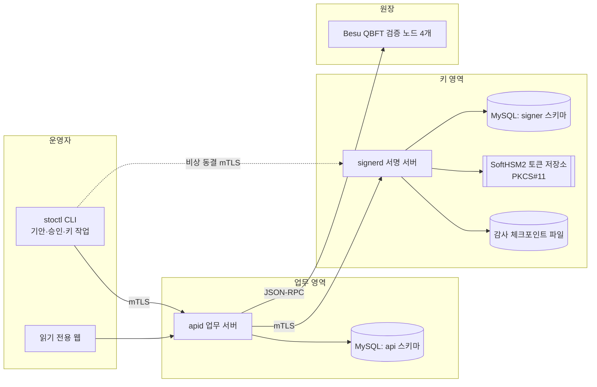
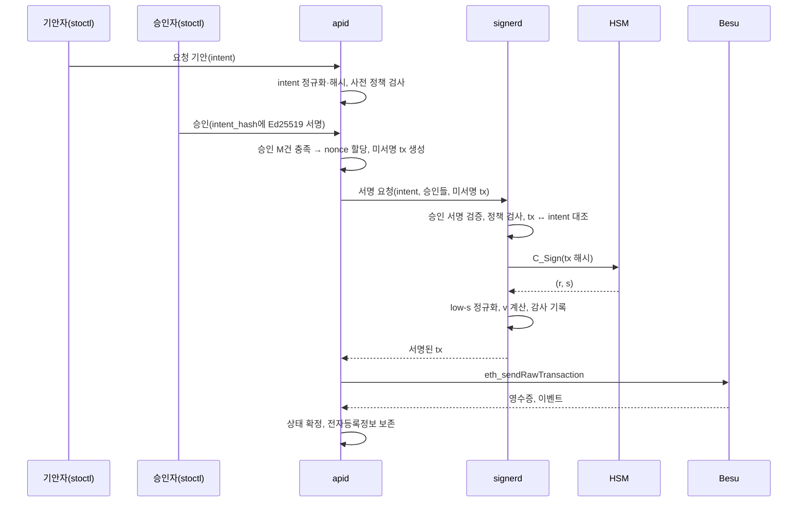
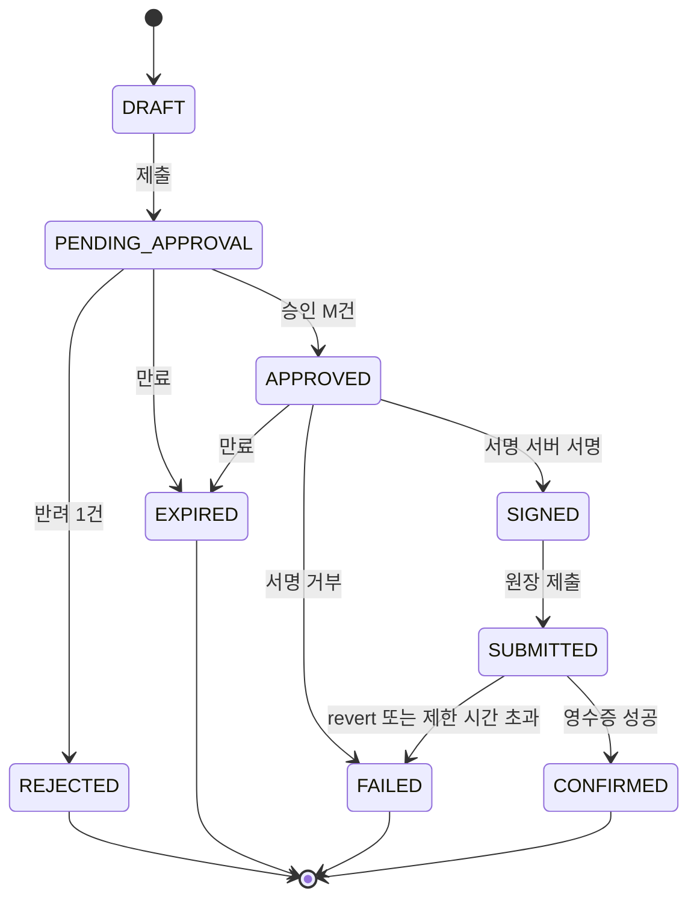

# 토큰증권 키 관리·서명 시스템 MVP — 개발 설계서

> 문서 버전: v1.2 (2026-11-27, M1 반영) · 요구사항: [01_개발요구사항_및_결정사항.md](01_개발요구사항_및_결정사항.md) · 작업지시서: [03_작업지시서.md](03_작업지시서.md)
>
> 이 설계서는 구현 전 설계다. "실측 필요"로 표시한 항목은 M0에서 확인한 뒤 결과를 요구사항 문서의 결정사항에 기록하고 이 문서를 고친다.

---

## 1. 설계 원칙

1. **키에 닿는 경로는 하나다.** HSM 토큰 저장소와 PIN은 서명 서버(`signerd`)만 접근한다.
2. **신뢰의 기준점은 서명 서버다.** 업무 서버(`apid`)가 침해되어도, 승인자 서명이 없는 요청과 정책 밖의 요청은 서명되지 않는다.
3. **서명 서버는 자기가 무엇에 서명하는지 안다.** 원문 트랜잭션을 해석해 승인된 내용과 일치하는지 확인한다.
4. **모든 권한 행사는 증적을 남긴다.** 감사로그는 추가 전용 해시 체인이고, 누구든 검증할 수 있다.
5. **교체 가능한 경계를 둔다.** 서명기(HSM, MPC)와 원장 어댑터(Besu, Fabric)는 인터페이스 뒤에 둔다.

## 2. 구성



| 구성 요소 | 실행 파일 | 역할 |
|---|---|---|
| 업무 서버 | `cmd/apid` | 요청 기안·승인 수집, 상태 기계, nonce 관리, 원장 제출, 이벤트 수신, 연계장부, 대사, 알람 |
| 서명 서버 | `cmd/signerd` | 승인 서명 검증, 정책 검사, 트랜잭션 해석, PKCS#11 서명, 키 생애주기, 동결, 감사 체크포인트 |
| 관리 CLI | `cmd/stoctl` | 기안, 승인(승인자 키로 서명), 키 작업 요청, 동결, 감사 검증, 시연 |
| HSM | SoftHSM2 | 키 생성·보관·서명. 서명 서버 컨테이너 안의 라이브러리이며 토큰 저장소 볼륨은 서명 서버만 마운트한다 |
| 원장 | Hyperledger Besu | QBFT 합의, 검증 노드 4개, 가스비 0, 허가형 |
| DB | MySQL 8 | `api`, `signer` 스키마를 분리하고 DB 계정도 분리한다 |

시연용 주체(D-8)

| 주체 | ID | HSM 토큰 | 보유 키 용도 |
|---|---|---|---|
| 플랫폼 운영 주체 | `platform` | `besu-local.platform` | 컨트랙트 관리(CONTRACT_ADMIN), 비상 통제(EMERGENCY) |
| 계좌관리기관 A | `inst-a` | `besu-local.inst-a` | 발행(ISSUE), 계좌대체(TRANSFER) |
| 계좌관리기관 B | `inst-b` | `besu-local.inst-b` | 계좌대체(TRANSFER) |
| 감사 | `audit` | `audit` | 감사 체크포인트 서명(AUDIT) |

## 3. 저장소 구조

```
sto-key-management-signing-mvp/
├─ CLAUDE.md
├─ Makefile
├─ go.mod
├─ cmd/
│  ├─ apid/            업무 서버
│  ├─ signerd/         서명 서버
│  └─ stoctl/          관리 CLI
├─ internal/
│  ├─ version/         실행 파일 버전 정보
│  ├─ config/          YAML 설정과 비밀 파일 읽기
│  ├─ server/          mTLS 서버 실행, 헬스 확인 호출
│  ├─ signsvc/         서명 서버의 tx 서명 처리(5.3 검사 순서)
│  ├─ intent/          요청 내용(intent) 구조, 정규화, 해시
│  ├─ approval/        승인자 키, 승인 서명 생성·검증
│  ├─ policy/          정책 모델과 평가
│  ├─ hsm/             PKCS#11 세션, 키 생성·서명·래핑
│  ├─ signer/          Signer 인터페이스, 키 용도·부류, EVM 서명 완성(cgo·hsm 의존 없음)
│  │  └─ hsm/          Signer 의 PKCS#11 구현
│  ├─ evmtx/           트랜잭션 생성, 해석(calldata 디코딩), intent 대조
│  ├─ keyreg/          키 레지스트리와 생애주기
│  ├─ audit/           해시 체인 감사로그, 검증, 체크포인트
│  ├─ ledger/          Ledger 어댑터 인터페이스
│  │  └─ besu/         Besu 구현
│  ├─ workflow/        요청 상태 기계
│  ├─ registry/        이벤트 수신, 전자등록정보 보존
│  ├─ linked/          연계장부, 대사
│  ├─ alarm/           이상 징후 규칙
│  ├─ store/           DB 접근(api, signer)
│  └─ transport/       mTLS 서버·클라이언트, HTTP 핸들러
├─ contracts/          Solidity 컨트랙트와 테스트
├─ migrations/
│  ├─ api/
│  └─ signer/
├─ deploy/
│  ├─ docker-compose.yml
│  ├─ besu/            genesis, 노드 키, 설정
│  ├─ signerd/         Dockerfile(SoftHSM2 포함), softhsm2.conf, signerd.yaml, bootstrap.yaml
│  ├─ apid/            Dockerfile, apid.yaml
│  ├─ mysql/           초기화 스크립트(스키마·계정), 헬스체크
│  ├─ secrets/         비밀 파일(생성물, 커밋 금지)
│  └─ certs/           로컬 CA와 인증서(생성물, 커밋 금지)
├─ scripts/            인증서 생성, 토큰 초기화, 실측(probe-hsm), 마이그레이션(dbmigrate), 시연
├─ test/               통합 테스트(-tags integration)
└─ docs/
   └─ 증빙/            실측·리허설 결과
```

## 4. 기술 선택

| 영역 | 선택 | 비고 |
|---|---|---|
| 언어 | Go | 착수 시점의 최신 안정 버전을 확인해 `go.mod`에 고정 |
| PKCS#11 | `github.com/miekg/pkcs11` | cgo 필요. 서명 서버 이미지에 SoftHSM2 라이브러리 포함 |
| EVM | `github.com/ethereum/go-ethereum` | 트랜잭션 타입, RLP, ABI, `ethclient`, `abigen` |
| HTTP | 표준 `net/http` | 외부 프레임워크 없이 구성 |
| DB | `database/sql` + `go-sql-driver/mysql`, 마이그레이션은 `golang-migrate`를 라이브러리로 쓰는 `scripts/dbmigrate` | ORM을 쓰지 않는다 |
| CLI | `cobra` | |
| 컨트랙트 | Solidity + OpenZeppelin, Foundry로 컴파일·테스트 | Go 바인딩은 `abigen` |
| 비밀 분할 | 검증된 공개 Shamir 구현 | 직접 구현하지 않는다 |
| 실행 | Docker Compose | |

버전은 이 문서에 적지 않는다. 착수 시점에 공식 문서로 확인해 `go.mod`, Dockerfile, `foundry.toml`에 고정한다.

M0에서 고정한 버전(공식 배포처에서 확인): Go 1.27.4, go-ethereum v1.17.10, miekg/pkcs11 v1.1.2, golang-migrate v4.20.1, go-sql-driver/mysql v1.10.2, Besu 26.11.2, MySQL 8.4.13, SoftHSM2 2.6.1(Debian trixie). 이후 버전은 `go.mod`, Dockerfile, Compose 파일이 기준이다.

## 5. 핵심 흐름

### 5.1 트랜잭션 서명 요청



### 5.2 intent와 승인

intent는 사람이 승인하는 대상이다. 원시 트랜잭션이 아니라 업무 의미를 담는다.

```json
{
  "request_id": "01JD…(ULID)",
  "type": "TX",
  "ledger_id": "besu-local",
  "institution_id": "inst-a",
  "key_purpose": "ISSUE",
  "contract": "0x…",
  "function": "issue(address,uint256)",
  "args": ["0x…", "1000"],
  "drafter_id": "apr-a-01",
  "expires_at": "2026-12-01T09:00:00Z"
}
```

- 정규화: 키를 사전순으로 정렬하고 공백 없는 UTF-8 JSON으로 직렬화한다(RFC 8785 방식). 숫자는 문자열로 표기한다.
- `intent_hash = SHA-256(정규화 바이트)`
- 정규 값 규칙(M1 구현, `internal/intent`): 같은 의미의 intent가 항상 같은 해시를 갖도록 비정규 표기는 거부한다.
  - `request_id`: 대문자 ULID 26자. `ledger_id`·`institution_id`·`drafter_id`: 소문자·숫자·`._-` 1~64자
  - `contract`와 address 인자: EIP-55 체크섬 표기
  - `function`: 공백 없는 정규 서명(예: `issue(address,uint256)`). 지원 타입은 `address`, `bool`, `string`, `bytes32`, `uint8`~`uint256`(별칭 `uint` 불가)
  - 수량(uintN): 선행 0 없는 10진수 문자열. `bytes32`: `0x` + 소문자 16진수 64자. `string`: 제어 문자 불가
  - `expires_at`: `YYYY-MM-DDTHH:MM:SSZ`(UTC, 소수점 없음). 알 수 없는 필드와 빠진 필드는 거부
  - 정규화 바이트는 HTML 이스케이프를 하지 않는다. 테스트 벡터는 `internal/intent/intent_test.go`에 있다.
- 미서명 tx 전송 형식: type 2 바이너리 인코딩(서명 필드 0)을 `0x` 16진수로 보낸다. 서명 서버는 다시 인코딩한 바이트가 입력과 같은지 확인한다.
- calldata 대조: 서명 서버는 intent에서 calldata를 다시 ABI 인코딩해 tx의 data와 바이트 단위로 비교한다(뒤에 붙은 바이트, 비정규 패딩 거부).
- 승인 서명: `Ed25519.Sign(승인자 개인키, "sto-approval-v1" || intent_hash || decision)`. `decision`은 `APPROVE` 또는 `REJECT`.
- 승인자 개인키는 `stoctl`이 암호로 보호한 로컬 키 파일로 보관한다. 공개키는 서명 서버의 `approvers` 테이블에 등록한다.
- nonce, 가스 한도는 intent에 넣지 않는다. 서명 서버가 정책으로 범위를 제한한다.

### 5.3 서명 서버의 검사 순서

하나라도 실패하면 서명하지 않고, 거부 사유를 감사로그에 남긴다.

1. mTLS 클라이언트 인증서가 허용된 호출자인지 확인
2. `request_id`가 이미 서명된 적이 있는지 확인. 같은 미서명 tx면 기존 결과를 돌려주고, 다르면 거부(D-6)
3. intent 스키마와 만료 시각 확인, `intent_hash` 재계산
4. 키 조회: `(ledger_id, institution_id, key_purpose)`에 해당하는 ACTIVE 키가 있고 동결되지 않았는지 확인
5. 정책 조회와 평가: 함수 허용 여부, 수량 한도, 수신 계좌 화이트리스트
6. 승인 검증: 서로 다른 유효 승인자 M명 이상, 승인자 그룹과 기관이 정책과 일치, 기안자 본인 제외, 서명 유효
7. 미서명 tx 해석: `chainId` 일치, `to == contract`, `value == 0`, calldata를 ABI로 디코딩한 함수·인자가 intent와 일치, 가스 가격 0, 가스 한도 상한 이내
8. HSM 서명 → low-s 정규화 → v 계산 → 공개키 복구로 주소 일치 확인
9. `signatures` 기록과 감사로그 기록을 한 DB 트랜잭션으로 저장한 뒤 응답

`request_id` 1회 서명 구현(2·8·9단계): 하나의 DB 트랜잭션 안에서 `signatures`에 `request_id` 행을 먼저 INSERT해 예약하고 → HSM 서명 → 같은 행에 `tx_hash`, `signed_tx`를 채우고 → 커밋한다. 같은 `request_id`의 동시 요청은 기본 키 잠금에서 기다렸다가 중복 키로 실패하고, 커밋된 행을 읽어 같은 미서명 tx면 저장된 `signed_tx`를 돌려주고 다르면 거부한다. HSM 서명이 실패하거나 커밋 전에 프로세스가 죽으면 행이 롤백되므로, 밖으로 나간 서명 없이 다시 시도할 수 있다.

### 5.4 요청 상태



- 서명 서버나 HSM이 응답하지 않으면 요청은 APPROVED에 머물고, 작업자가 주기적으로 재시도한다(NFR-4).
- SIGNED 이후 제출이 실패하면 같은 서명된 tx를 다시 제출한다. 서명은 다시 받지 않는다.
- 상태 전이는 `UPDATE … WHERE status = 이전상태`의 조건부 갱신으로 처리해 중복 처리를 막는다.

### 5.5 nonce 관리

- `api.nonces(ledger_id, address)` 행을 `SELECT … FOR UPDATE`로 잠그고 할당한다.
- 할당은 APPROVED 직후 미서명 tx를 만들 때 한 번만 한다. 할당된 nonce는 요청에 저장한다.
- FAILED로 끝난 요청이 nonce를 점유했는데 체인에 반영되지 않았다면, 다음 요청이 막힌다. 작업자가 체인의 `eth_getTransactionCount(pending)`와 비교해 빈 nonce를 다음 요청에 재사용한다.

## 6. HSM 설계

### 6.1 토큰과 키

- 토큰은 `(원장, 기관)` 단위로 만든다. 토큰마다 PIN이 다르다.
- PIN은 Docker secret 파일로 서명 서버에만 전달한다. 환경 변수와 로그에 남기지 않는다(NFR-1).
- 서명 키: EC secp256k1(`CKA_EC_PARAMS` = OID 1.3.132.0.10의 DER `06 05 2B 81 04 00 0A`). `CKA_SIGN=true`, `CKA_SENSITIVE=true`, `CKA_TOKEN=true`, `CKA_PRIVATE=true`.
- SoftHSM2는 토큰 초기화 뒤 슬롯 ID를 다시 배정하므로 슬롯은 토큰 라벨로 찾는다.
- 서명 서버 컨테이너는 non-root `signer` 사용자로 실행하고 `softhsm` 그룹에 넣는다(Debian 패키지의 설정·토큰 디렉터리 권한).
- 키 식별: `CKA_LABEL = key_id`, `CKA_ID = key_id 바이트`.

| 부류 | 용도 | `CKA_EXTRACTABLE` | 백업 | 분실 시 |
|---|---|---|---|---|
| 운영 키 | ISSUE, TRANSFER | false | 없음 | 관리 키로 온체인 역할을 새 키에 부여(교체) |
| 루트 키 | CONTRACT_ADMIN, EMERGENCY | true (래핑으로만) | 래핑 백업 | 백업에서 복구 |
| 감사 키 | AUDIT | false | 없음 | 새 키로 교체, 이전 공개키는 검증용으로 보존 |

### 6.2 EVM 서명 완성 (FR-1.5)

1. 서명 서버가 트랜잭션 서명 해시(32바이트)를 계산한다.
2. `C_Sign(CKM_ECDSA)`로 64바이트 `r || s`를 받는다.
3. `s > n/2`이면 `s = n - s`로 바꾼다.
4. 복구 식별자 0과 1로 각각 공개키를 복구해, 레지스트리의 공개키와 일치하는 값을 고른다.
5. 트랜잭션 유형에 맞게 v(또는 yParity)를 넣어 직렬화한다.

### 6.3 백업과 복구 (FR-5.4)

1. **래핑 키 의식**: `stoctl key ceremony`가 AES-256 래핑 키를 메모리에서 생성해 Shamir 2-of-3으로 분할하고, 조각을 보관자별 파일로 내보낸다. 래핑 키는 HSM에 추출 불가 토큰 객체로 넣고 메모리에서 지운다.
2. **백업**: `C_WrapKey`(AES 키 랩 패딩 메커니즘)로 루트 키를 암호화해 파일로 저장한다. 파일에는 key_id, 공개키, 래핑 메커니즘, 암호문, 생성 시각을 담는다.
3. **복구 리허설**: 빈 토큰을 새로 초기화 → 조각 2개로 래핑 키 복원·주입 → `C_UnwrapKey`로 루트 키 복원 → 같은 주소가 나오는지, 서명이 검증되는지 확인 → 결과를 `docs/증빙/복구리허설_YYYYMMDD.md`에 남긴다.

실측 결과(M0, SoftHSM2 2.6.1에서 확정)

- secp256k1 키 생성(`CKM_EC_KEY_PAIR_GEN`)과 `CKM_ECDSA` 서명을 지원한다. `CKA_EC_POINT`는 DER OCTET STRING으로 감싼 65바이트 비압축 점이고, 서명은 64바이트 `r ‖ s`다. s는 정규화되지 않아 약 절반이 high-s다([실측_HSM_서명.md](증빙/실측_HSM_서명.md)).
- 래핑 메커니즘은 SoftHSM2 2.6.1이 구현한 `CKM_AES_KEY_WRAP_PAD`(`0x210A`)로 확정한다. 래핑 결과 형식은 구현마다 다를 수 있으므로 백업 파일은 같은 HSM 구현으로만 복원한다고 가정한다. EC 개인키의 `C_WrapKey`와 빈 토큰에서의 `C_UnwrapKey`가 동작하고, 복원한 키의 주소가 원본과 같다. 추출 불가 키의 래핑은 `CKR_KEY_UNEXTRACTABLE`로 거부된다([실측_HSM_래핑.md](증빙/실측_HSM_래핑.md)).
- 래핑 키 객체 속성: `CKK_AES`(256비트), `CKA_TOKEN`·`CKA_PRIVATE`·`CKA_SENSITIVE`·`CKA_WRAP`·`CKA_UNWRAP` true, `CKA_EXTRACTABLE`·`CKA_ENCRYPT`·`CKA_DECRYPT` false.
- 복원 템플릿: `CKO_PRIVATE_KEY`, `CKK_EC`, `CKA_TOKEN`·`CKA_PRIVATE`·`CKA_SENSITIVE`·`CKA_SIGN`·`CKA_EXTRACTABLE` true, `CKA_LABEL`·`CKA_ID` = key_id. `CKA_EXTRACTABLE`을 true로 둬야 복원한 루트 키를 다시 백업할 수 있다.
- `C_UnwrapKey`는 개인키 객체만 만든다. 주소 확인은 백업 파일의 공개키와 "서명 → 공개키 복구"로 한다.
- 대체 방식(토큰 저장소 암호화 사본)은 쓰지 않는다.

### 6.4 Signer 인터페이스

```go
type Signer interface {
    // 키 쌍을 만들고 공개키를 돌려준다.
    Generate(ctx context.Context, spec KeySpec) (PublicKey, error)
    // 32바이트 다이제스트에 서명하고 (r, s)를 돌려준다. low-s 정규화는 호출자가 한다.
    SignDigest(ctx context.Context, keyID string, digest [32]byte) (r, s *big.Int, err error)
    Destroy(ctx context.Context, keyID string) error
}
```

HSM 구현은 `internal/signer/hsm`, MPC 구현(M5)은 `internal/signer/mpc`에 둔다.

- 키 부류와 추출 가능 여부는 호출자가 고르지 않고 `KeySpec.Purpose`에서 정한다(`signer.ClassOf`, D-3).
- HSM 구현은 `keyID → 토큰 라벨` 조회기(키 레지스트리)를 받아 해당 토큰에서만 서명한다. 토큰마다 세션 풀을 두고, 서명 한 번은 세션 하나를 독점한다.
- `internal/signer`는 cgo와 `internal/hsm`에 의존하지 않는다. `internal/hsm` import는 서명 서버(`cmd/signerd`, `internal/signer/hsm`)만 한다.

## 7. 정책과 권한

### 7.1 역할

| 역할 | 소속 | 할 수 있는 일 |
|---|---|---|
| 기안자 | 기관 | 업무 요청 기안 |
| 승인자 | 기관 | 소속 기관 요청 승인·반려 |
| 보안관리자 | 플랫폼 | 키 작업·정책 변경 승인, 즉시 동결 |

한 사람이 여러 역할을 가질 수 있지만, 자기가 기안한 요청은 승인하지 못한다.

### 7.2 정책 모델

```yaml
policy_id: pol-inst-a-issue
ledger_id: besu-local
institution_id: inst-a
key_purpose: ISSUE
allowed_functions: ["issue(address,uint256)", "redeem(address,uint256)"]
max_amount: "100000"            # 인자 중 수량의 상한
recipient_whitelist: true       # 수신 계좌가 화이트리스트에 있어야 함
required_approvals: 2           # M
approver_group: inst-a-approvers
gas_limit_cap: 500000
```

- 정책과 승인자 명부는 서명 서버의 DB에 있다. 업무 서버는 조회만 한다.
- 초기 값은 `signerd init --bootstrap bootstrap.yaml`로 한 번만 넣고 감사로그에 남긴다. 이후 변경은 보안관리자 M-of-N 승인이 붙은 `POLICY_CHANGE` 요청으로만 한다(FR-3.4).

### 7.3 동결 (FR-3.5, D-5)

- 범위: 키, 기관, 원장.
- 동결: 보안관리자 1인이 서명한 요청을 서명 서버가 직접 받는다. 업무 서버가 죽어 있어도 동작해야 한다.
- 해제: 보안관리자 M-of-N 승인.
- 동결된 범위의 서명 요청은 5.3의 4단계에서 거부된다.

### 7.4 알람

| 규칙 | 조건(기본값) | 동작 |
|---|---|---|
| 고액 | 수량이 정책 한도의 80% 이상 | 알람 기록 |
| 반복 | 같은 키로 10분 안에 5건 이상 | 알람 기록 |
| 거부 반복 | 같은 기안자의 요청이 10분 안에 3건 이상 서명 거부 | 알람 기록 |
| 총량 불일치 | 대사에서 불일치 발견 | 알람 기록 |

알람은 `api.alarms`에 남기고 로그로 출력한다. 자동 동결은 하지 않는다.

## 8. 감사로그 (FR-4)

- `api.audit_log`와 `signer.audit_log` 두 체인을 같은 라이브러리(`internal/audit`)로 관리한다.
- 레코드: `seq, ts, actor, action, subject, payload_json, prev_hash, hash`
- `hash = SHA-256(seq || ts || actor || action || subject || payload_json || prev_hash)`. 필드는 길이 접두 방식으로 이어 붙인다.
- 추가는 체인 머리 행을 잠근 DB 트랜잭션 안에서 한다.
- DB 계정에는 감사 테이블(`audit_log`, signer의 `audit_checkpoints`)에 `INSERT`, `SELECT`만 준다(NFR-2).
  - 계정: 스키마별 마이그레이션 계정(`api_migrator`, `signer_migrator`)과 서버용 계정(`api_app`, `signer_app`)을 나눈다. 서버용 계정은 DDL 권한이 없고 다른 스키마에 접근하지 못한다.
  - MySQL은 스키마 권한에서 특정 테이블만 뺄 수 없으므로, `make migrate`가 마이그레이션 뒤 실제 테이블 목록을 보고 테이블 단위로 권한을 준다. 새 테이블을 추가하는 마이그레이션도 `make migrate`로 권한이 함께 부여된다.
  - 검증: `test/dbgrants_test.go`(`make it`)가 서버용 계정의 감사 테이블 `UPDATE`·`DELETE`가 거부되는지 확인한다.
  - T2.1 제약(M0 실측): 서버용 계정은 감사 테이블에 `SELECT … FOR UPDATE`를 할 수 없다(MySQL은 잠금 읽기에 `UPDATE`·`DELETE`·`LOCK TABLES` 중 하나를 요구, 오류 1142). 따라서 "체인 머리 행 잠금"은 `audit_log` 행 잠금이 아닌 다른 방법(예: 별도 머리 테이블, 명명 잠금)으로 구현해야 한다. 방식은 T2.1에서 정해 이 절을 고친다.
- 체크포인트: 서명 서버가 주기적으로 두 체인의 `(seq, hash)`를 AUDIT 키로 서명해 `signer.audit_checkpoints`와 체크포인트 파일 볼륨에 쓴다(FR-4.3).
- 검증: `stoctl audit verify`가 전 구간의 해시를 다시 계산하고, 체크포인트 서명을 공개키로 확인한다. 어긋난 첫 `seq`를 보고한다.
- 개인키, PIN, 래핑 키, 승인자 개인키는 payload에 넣지 않는다.

## 9. 키 생애주기 (FR-5)

키 상태: `ACTIVE → FROZEN ↔ ACTIVE`, `ACTIVE → RETIRED → DESTROYED`.

| 작업 | 절차 |
|---|---|
| 생성 | 승인된 `KEY_GENERATE` 요청 → HSM 생성 → 레지스트리 등록(공개키, 주소) → 감사 기록 |
| 교체 | 새 키 생성 → 관리 키로 컨트랙트 역할을 새 주소에 부여 → 이전 주소 역할 회수 → 이전 키 RETIRED → 감사 기록. 각 온체인 단계는 승인이 붙은 TX 요청이다 |
| 폐기 | RETIRED 키에만 가능 → `C_DestroyObject` → 객체가 없는지 확인 → DESTROYED → 감사 기록(폐기 증적) |
| 백업·복구 | 6.3 |
| 분실·도난 대응 | ① 키 동결(1인) ② 관리 키로 온체인 역할 회수 ③ 필요하면 비상 통제 키로 종목 유통 정지 ④ 새 키 생성과 역할 부여 ⑤ 유통 재개 ⑥ 이전 키 폐기. `scripts/incident-key-compromise.sh`로 순서대로 실행한다 |

관리 키 자체의 교체: 새 관리 키에 관리자 역할을 부여한 뒤 이전 키가 역할을 포기한다. 두 단계 사이에 관리자 역할이 비지 않게 순서를 지킨다.

T3.5 제약(M1 구현에서 확인): 키 조회 `Lookup(원장, 기관, 용도)`는 ACTIVE 키가 둘 이상이면 임의로 고르지 않고 거부한다(`ErrAmbiguousKey`). 교체 중에는 새 키와 이전 키가 같은 범위에 함께 있으므로, 새 키를 ACTIVE가 아닌 상태로 등록했다가 이전 키 퇴역과 함께 전환하는 등 T3.5에서 방식을 정해 이 절을 고친다.

## 10. 분산원장 연계 (FR-6)

### 10.1 네트워크

- Besu QBFT, 검증 노드 4개(장애 1개 허용), 허가형.
- 가스비 0(B-5-2). Besu 공식 문서의 가스비 없는 네트워크 절차를 따른다(D-10).
  - genesis: `zeroBaseFee: true`, `baseFeePerGas: 0`, `gasLimit: 0x1fffffffffffff`, `contractSizeLimit: 2147483647`, `pragueTime: 0`
  - 모든 노드: `min-gas-price=0`, `tx-pool-enable-balance-check=false`
- 트랜잭션 유형: EIP-1559(type 2), `maxFeePerGas = maxPriorityFeePerGas = 0`. 서명 서버는 두 값이 0인지, 가스 한도가 정책 상한 이내인지 검사한다(5.3의 7단계).
- QBFT: `blockperiodseconds: 2`, `requesttimeoutseconds: 4`, chainId `20261124`.
- 허가형 범위(MVP): 검증 노드 집합은 genesis `extraData`에 고정하고, P2P는 정적 피어만 허용한다. Besu의 노드·계정 허가 목록(permissioning) 기능은 켜지 않았다. 트랜잭션 송신 권한은 컨트랙트 역할(10.2)로 통제한다.
- 노드 키와 genesis(`extraData`의 검증 노드 목록)는 `scripts/gen-besu-network.sh`가 `deploy/besu/generated/`에 만든다. 노드 키는 개인키이므로 커밋하지 않는다.
- P2P는 디스커버리를 끄고 정적 피어(`static-nodes.json`)만 쓴다. 외부 공개망에 붙을 경로를 두지 않는다.
- RPC 포트는 Compose 내부 네트워크에만 노출하고, 호스트에는 개발용 노드 하나(node1)만 `127.0.0.1:8545`로 바인딩한다(C-1-2).
- 점검: `scripts/check-besu.sh [--fault-test]`가 블록 생성, 검증 노드 4개, 잔액 0 계정의 가스비 0 트랜잭션 확정, 노드 하나 중지 시 블록 생성 지속을 확인한다.

### 10.2 토큰증권 컨트랙트

종목마다 `SecurityToken` 하나를 배포한다(D-3-1). 소수 자리는 0이다.

| 역할 | 보유자 | 함수 |
|---|---|---|
| `DEFAULT_ADMIN_ROLE` | 플랫폼 CONTRACT_ADMIN 키 | 역할 부여·회수 |
| `ISSUER_ROLE` | 기관 ISSUE 키 | `issue(account, amount)`, `redeem(account, amount)` |
| `TRANSFER_AGENT_ROLE` | 기관 TRANSFER 키 | `transferByAgent(from, to, amount)`, `registerAccount(account, institutionId)`, `setAccountRestricted(account, restricted)` |
| `CONTROLLER_ROLE` | 플랫폼 EMERGENCY 키 | `setCirculation(status)`, `pause()`, `unpause()` |

규칙

- 등록된 계좌끼리만 보유·이전할 수 있다.
- `transferByAgent`는 호출 키의 기관이 `from` 계좌의 기관과 같을 때만 허용한다(B-2-2). 키 주소와 기관의 대응은 컨트랙트에 등록한다.
- 처분제한된 계좌는 출고할 수 없다.
- 종목 유통 상태가 정지이면 계좌대체가 막힌다(D-3-2). 발행·말소는 `pause`로만 막는다.
- 일반 ERC-20의 `transfer`, `approve`는 제공하지 않는다. 계좌별 개인키가 없기 때문이다(D-7).

이벤트: `Issued`, `Redeemed`, `Transferred`, `AccountRegistered`, `AccountRestrictionChanged`, `CirculationChanged`, `Paused`, `Unpaused`.

### 10.3 Ledger 어댑터 인터페이스

```go
type Ledger interface {
    ChainID(ctx context.Context) (*big.Int, error)
    // intent를 미서명 트랜잭션으로 만든다.
    BuildTx(ctx context.Context, in Intent, from common.Address, nonce uint64) (UnsignedTx, error)
    // 서명 서버가 쓴다. 미서명 tx를 해석해 intent와 일치하는지 확인한다.
    VerifyTx(in Intent, tx UnsignedTx) error
    Submit(ctx context.Context, raw []byte) (TxHash, error)
    Receipt(ctx context.Context, h TxHash) (*Receipt, error)
    PendingNonce(ctx context.Context, addr common.Address) (uint64, error)
    Events(ctx context.Context, contract common.Address, from, to uint64) ([]Event, error)
    BalanceOf(ctx context.Context, contract, account common.Address) (*big.Int, error)
    TotalSupply(ctx context.Context, contract common.Address) (*big.Int, error)
}
```

`VerifyTx`는 네트워크에 접근하지 않는 순수 함수로 만든다. 서명 서버는 원장 노드에 연결하지 않는다.

### 10.4 이벤트 수신과 전자등록정보 보존 (FR-6.4)

- `api.ledger_cursor`에 종목별 마지막 처리 블록을 저장한다.
- 작업자가 `[cursor+1, head-확정깊이]` 구간의 로그를 읽어 `api.registry_events`에 저장하고 커서를 같은 DB 트랜잭션으로 갱신한다.
- 중복 방지: `(ledger_id, tx_hash, log_index)` 유니크 키.
- QBFT는 블록이 즉시 확정되므로 확정 깊이 기본값은 0이고, 설정으로 바꿀 수 있다.
- 저장 항목: 블록 번호, 블록 해시, 블록 시각, tx 해시, 로그 인덱스, 이벤트 이름, 디코딩된 내용, 원본 로그.

## 11. 연계장부와 대사 (FR-7)

- `api.accounts`: 계좌번호, 기관, 모의 권리자 이름, 온체인 주소, 상태. 실명 정보는 원장에 올리지 않는다(E-2-1).
- 온체인 주소는 계좌 등록 시 무작위로 만든 20바이트 값이다. 개인키가 없다(D-7).
- `api.holdings`: 계좌·종목별 수량. 확정된 이벤트를 반영해 갱신한다.
- 대사 배치: 종목별로 ① 계좌별 `balanceOf`와 `holdings` ② `totalSupply`와 `holdings` 합계 ③ `registry_events` 재생 결과와 `holdings`를 비교한다.
- 결과는 `api.recon_runs`, `api.recon_diffs`에 남기고, 불일치가 있으면 알람을 낸다(D-2-3 초과분 감지).

## 12. 데이터 모델

### 12.1 signer 스키마

| 테이블 | 주요 컬럼 |
|---|---|
| `hsm_tokens` | `token_id, label, ledger_id, institution_id, status` (감사 토큰은 원장에 속하지 않으므로 `ledger_id = global`, `institution_id = audit`) |
| `keys` | `key_id, token_id, purpose, class(OPERATIONAL/ROOT/AUDIT), public_key, address, status, rotated_from, created_at, retired_at, destroyed_at` |
| `approvers` | `approver_id, name, institution_id, role, ed25519_pubkey, status` |
| `approver_groups` | `group_id, approver_id` |
| `policies` | `policy_id, version, ledger_id, institution_id, key_purpose, body_json, status` |
| `whitelists` | `policy_id, account_address` |
| `signatures` | `request_id(PK), key_id, intent_hash, unsigned_tx_hash, tx_hash, signed_tx, signed_at` (`signed_tx`: 서명된 tx 원문. 같은 요청의 재호출에 다시 서명하지 않고 돌려주기 위함, D-6) |
| `key_ops` | `request_id(PK), type, intent_hash, key_id, result, done_at` |
| `freezes` | `freeze_id, scope, target, reason, frozen_by, frozen_at, released_request_id, released_at` |
| `audit_log` | `seq(PK), ts, actor, action, subject, payload_json, prev_hash, hash` |
| `audit_checkpoints` | `id, chain, seq, head_hash, key_id, signature, ts` |

### 12.2 api 스키마

| 테이블 | 주요 컬럼 |
|---|---|
| `requests` | `request_id(PK), type, ledger_id, institution_id, intent_json, intent_hash, status, drafter_id, signer_address, nonce, unsigned_tx, raw_tx, tx_hash, error, expires_at, created_at, updated_at` |
| `approvals` | `request_id, approver_id, decision, signature, created_at`, 유니크 `(request_id, approver_id)` |
| `nonces` | `ledger_id, address, next_nonce` |
| `securities` | `issue_code(PK), name, ledger_id, contract_address, circulation_status` |
| `ledger_cursor` | `ledger_id, contract_address, last_block` |
| `registry_events` | `id, ledger_id, block_number, block_hash, block_time, tx_hash, log_index, event, payload_json, raw_log`, 유니크 `(ledger_id, tx_hash, log_index)` |
| `accounts` | `account_no(PK), institution_id, holder_name, onchain_address, status` |
| `holdings` | `account_no, issue_code, quantity` |
| `recon_runs`, `recon_diffs` | 실행 시각, 종목, 비교 종류, 기대값, 실제값 |
| `alarms` | `alarm_id, rule, subject, detail_json, created_at` |
| `audit_log` | signer와 같은 구조 |

금액·수량은 문자열 또는 DECIMAL(65,0)로 저장하고, Go에서는 `*big.Int`로 다룬다.

해시나 서명의 대상이 되는 JSON(`intent_json`, `payload_json`, `body_json`, `raw_log`)은 MySQL `JSON` 형식이 키 순서와 공백을 바꾸므로 `utf8mb4_bin` 텍스트로 저장해 바이트를 보존한다. `keys`는 MySQL 예약어라 SQL에서 백틱으로 감싼다.

## 13. API

### 13.1 signerd (mTLS, 호출자: apid, stoctl)

| 메서드 | 경로 | 내용 |
|---|---|---|
| POST | `/v1/sign/tx` | intent, 승인들, 미서명 tx → 서명된 tx. 호출자는 apid만. M1에서는 5·6단계가 없어 통합 시험용 빌드 태그 `signtx_m1`로만 열린다(기본 빌드는 404). T2.4에서 태그를 없앤다 |
| POST | `/v1/key-ops` | 승인된 키 작업(생성, 퇴역, 폐기, 백업, 복구) 실행 |
| POST | `/v1/policy-changes` | 승인된 정책·승인자 변경 적용 |
| POST | `/v1/freezes` | 즉시 동결(보안관리자 1인 서명) |
| POST | `/v1/freezes/{id}/release` | 동결 해제(M-of-N) |
| GET | `/v1/keys`, `/v1/policies`, `/v1/approvers`, `/v1/freezes` | 조회 |
| GET | `/v1/audit/head`, `/v1/audit/records` | 감사 체인 조회 |
| GET | `/healthz` | HSM 세션, DB 상태 |

### 13.2 apid (mTLS, 호출자: stoctl / 읽기 전용 웹은 별도 포트)

| 메서드 | 경로 | 내용 |
|---|---|---|
| POST | `/v1/requests` | 기안 |
| POST | `/v1/requests/{id}/approvals` | 승인·반려(승인자 서명 포함) |
| GET | `/v1/requests`, `/v1/requests/{id}` | 조회 |
| GET | `/v1/securities`, `/v1/accounts`, `/v1/holdings` | 조회 |
| POST | `/v1/accounts` | 연계장부 계좌 등록(온체인 등록 요청을 함께 기안) |
| POST | `/v1/recon/run`, GET `/v1/recon/runs` | 대사 실행·조회 |
| GET | `/v1/alarms`, `/v1/registry-events` | 조회 |
| GET | `/healthz` | DB, RPC, 서명 서버 상태 |

오류 응답은 `{"code": "POLICY_AMOUNT_EXCEEDED", "message": "…"}` 형식으로 통일한다. 서명 거부 코드는 5.3의 검사 단계와 1:1로 대응시킨다.

`/v1/sign/tx` 요청·응답과 거부 코드(M1 구현, `internal/signsvc`):

- 요청: `{"intent": {…}, "intent_hash": "<64 hex>", "approvals": [], "unsigned_tx": "0x…"}`. 응답: `{"request_id", "key_id", "address", "tx_hash", "signed_tx"}`. 거부: `{"step", "code", "message"}`

| 단계 | 코드 |
|---|---|
| 1 | `SIGN_CALLER_NOT_ALLOWED` |
| 2 | `SIGN_REQUEST_CONFLICT` |
| 3 | `INTENT_INVALID`, `INTENT_EXPIRED`, `INTENT_HASH_MISMATCH`, `LEDGER_UNKNOWN` |
| 4 | `KEY_NOT_AVAILABLE`, `KEY_FROZEN` |
| 5·6 | M2에서 추가 |
| 7 | `TX_INVALID`, `TX_CHAIN_ID_MISMATCH`, `TX_TO_MISMATCH`, `TX_VALUE_NONZERO`, `TX_FEE_NONZERO`, `TX_GAS_LIMIT_EXCEEDED`, `TX_ACCESS_LIST_NOT_EMPTY`, `TX_CALLDATA_MISMATCH` |
| 8 | `HSM_SIGN_FAILED`, `SIGNATURE_ADDRESS_MISMATCH` |
| 9 | `SIGN_STORE_FAILED` |

가스 한도 상한은 정책(T2.3)이 생기기 전까지 signerd 설정 `signing.max_gas_limit`(500000)를 쓴다.

## 14. 보안 설계와 위협 모델

| 위협 | 대응 |
|---|---|
| 업무 서버 침해 후 임의 서명 시도 | 승인자 서명 M건이 없으면 거부. 정책과 승인자 명부는 서명 서버에 있다 |
| 승인된 내용과 다른 트랜잭션으로 바꿔치기 | 서명 서버가 calldata를 해석해 intent와 대조 |
| 승인 재사용(재전송) | `request_id`당 서명 1회, intent에 만료 시각 |
| 기안자의 자기 승인 | intent의 `drafter_id`와 승인자 비교 |
| 다른 기관 키 사용 | 키 조회가 `(원장, 기관, 용도)`로 고정. 토큰과 PIN 분리. 컨트랙트도 기관 일치 검사 |
| 키 탈취·분실 | 운영 키 추출 불가, 동결, 온체인 역할 회수, 교체 |
| 감사로그 변조 | 해시 체인, DB 권한 분리, HSM 서명 체크포인트 |
| PIN·키 유출 | Docker secret, 로그 마스킹, 저장소 커밋 금지 목록 |
| 서명 서버 무단 호출 | mTLS, 클라이언트 인증서 CN 허용 목록 |

MVP의 한계(문서에 명시)

- SoftHSM2는 소프트웨어 구현이라 물리 보호와 인증 등급이 없다. PKCS#11 표준 인터페이스이므로 실물 HSM으로 교체할 수 있다.
- 서명 서버 호스트가 침해되면 토큰 파일과 PIN이 함께 노출된다. 운영 환경에서는 네트워크 HSM과 망 분리로 해결한다.
- 승인자 키가 로컬 파일이다. 운영 환경에서는 보안 토큰이나 인증서 기반 전자서명으로 바꾼다.

## 15. 설정과 비밀

| 항목 | 전달 방식 |
|---|---|
| HSM PIN(토큰별) | Docker secret 파일 |
| DB 비밀번호 | Docker secret 파일 |
| TLS 인증서·키 | `deploy/certs/` 볼륨(스크립트 생성, 커밋 금지) |
| 일반 설정(포트, RPC 주소, chainId, 확정 깊이, 알람 기준) | YAML 설정 파일 |
| 승인자 개인키 | `stoctl` 로컬 키 파일(암호 보호, 커밋 금지) |

기동 점검: 설정 검증 → DB 연결과 마이그레이션 버전 확인 → (signerd) HSM 토큰 로그인과 레지스트리의 ACTIVE 키가 HSM에 실제로 있는지 대조 → (apid) RPC `chainId` 일치 확인. 하나라도 실패하면 기동하지 않는다.

M1 구현:

- 설정 파일: `deploy/signerd/signerd.yaml`, `deploy/apid/apid.yaml`. 알 수 없는 키는 거부한다. 비밀은 `*_file` 경로로만 가리킨다.
- 비밀 파일(`scripts/gen-secrets.sh`): `hsm_pin_<기관>`, `hsm_so_pin_<기관>`(기관: platform, inst-a, inst-b, audit), DB 계정 비밀번호. SO PIN은 일회성 `signerd-setup` 서비스에만 마운트한다.
- 기동 순서(`make up`): 인프라 → 마이그레이션 → `signerd init-tokens`(멱등) → `signerd init --bootstrap`(한 번만, 이미 적용이면 건너뜀) → signerd, apid. 같은 토큰 볼륨을 두 프로세스가 동시에 쓰지 않도록 토큰 초기화·부트스트랩은 signerd를 멈춘 상태에서 한다.
- 레지스트리 대조는 ACTIVE·FROZEN 키에 대해 HSM의 개인키·공개키 객체가 있고 공개키가 같은지 확인한다.
- `/healthz`도 mTLS다. 컨테이너 헬스체크는 `signerd healthcheck`, `apid healthcheck`가 자기 인증서로 자기 `/healthz`를 부른다(평문 포트 없음).
- 서버 인증서 SAN: `signerd`/`apid`, `localhost`, `127.0.0.1`. EKU: signerd·apid는 서버·클라이언트, stoctl은 클라이언트.
- 파일 권한: 개인키(`deploy/certs/*.key`)와 비밀 파일(`deploy/secrets/*`)은 0600, 디렉터리는 0700이다. Docker Desktop(macOS)은 바인드 마운트 파일을 컨테이너 사용자 소유로 보여 주므로 비 root 컨테이너가 읽을 수 있음을 실측했다. Linux Docker Engine에서는 파일 소유자를 컨테이너 uid(signerd 10001, apid 10002, MySQL 999)로 바꿔야 한다(MVP 한계).

## 16. 테스트 전략

| 종류 | 대상 | 실행 |
|---|---|---|
| 단위 | intent 정규화·해시, 승인 검증, 정책 평가, tx 해석·대조, low-s·v 계산, 감사 체인, 상태 전이 | `make test` |
| 컨트랙트 | 역할 권한, 기관 일치, 처분제한, 유통 정지 | `make test-contracts` |
| 통합 | SoftHSM2·MySQL·Besu를 띄우고 전체 흐름과 거부 사례. 호스트(DB·서버 mTLS) → SoftHSM2 컨테이너(`scripts/it-hsm.sh`, tmpfs 토큰) → 서명 서버 종단(`scripts/it-signtx.sh`, signtx_m1 빌드로 교체 후 복원) | `make it` |
| 시연 | 정상 흐름, 거부 사례, 키 교체, 도난 대응, 감사 검증 | `make demo` |

반드시 있어야 하는 거부 사례 테스트(NFR-5)

- 승인 수 부족, 기안자의 자기 승인, 등록되지 않은 승인자, 위조된 승인 서명
- 승인 후 intent 변조, 승인된 intent와 다른 calldata
- 수량 한도 초과, 화이트리스트 밖 수신 계좌, 허용되지 않은 함수
- 다른 기관의 키 용도로 요청, 동결된 키, RETIRED·DESTROYED 키
- 같은 `request_id`로 다른 tx 재서명
- 만료된 요청
- 감사로그 한 행을 직접 고친 뒤 검증 실패 확인

## 17. 확장 설계 (M5)

- **MPC 서명기**: `Signer` 인터페이스의 두 번째 구현. 공개 TSS 라이브러리로 2-of-3 임계값 ECDSA를 구성하고, 키 조각을 세 프로세스에 나눈다. 5.3의 검사는 그대로 쓰고 8단계만 바뀐다.
- **Fabric 어댑터**: `Ledger` 인터페이스의 두 번째 구현. 신원 인증서의 개인키를 PKCS#11로 HSM에 두고, Fabric CA에서 인증서를 발급·갱신·폐기하는 절차를 키 생애주기에 추가한다.
